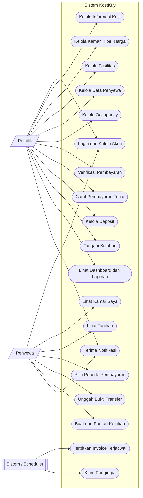
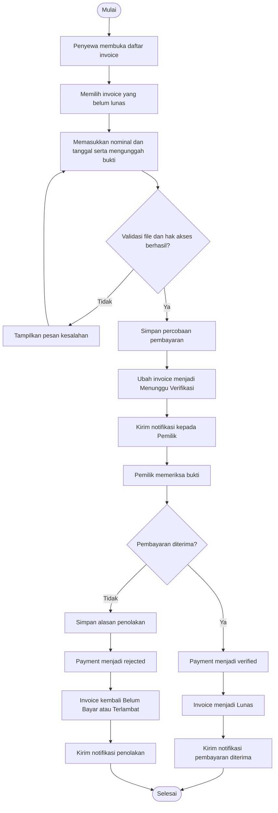
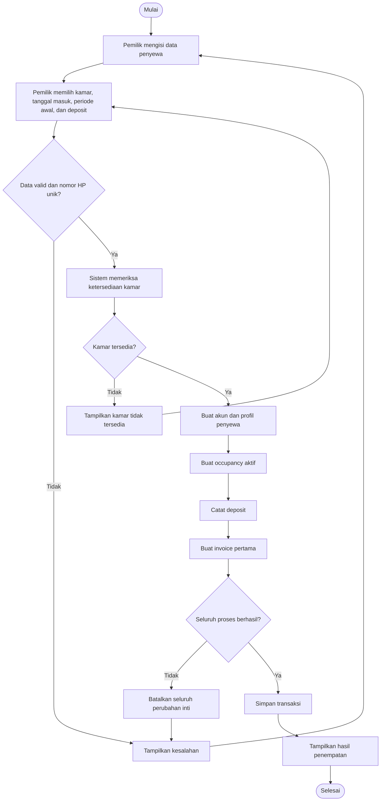
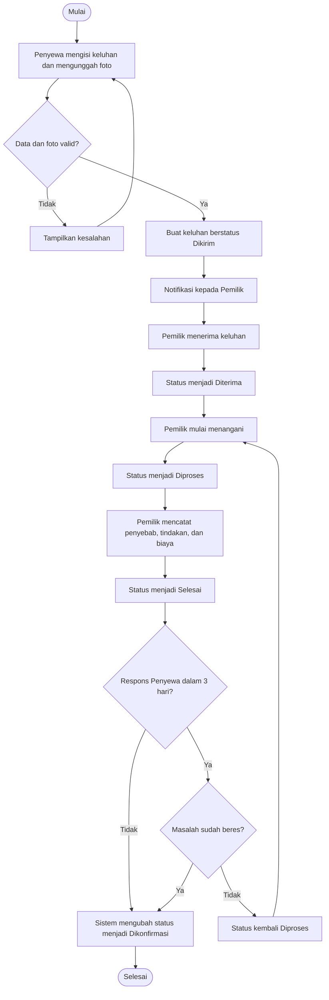
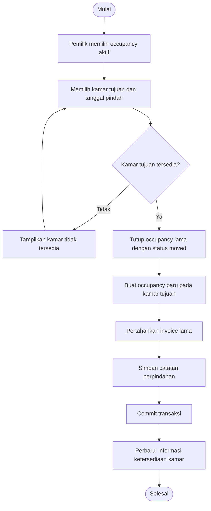

# Software Requirements Specification (SRS)
# KostKuy – Aplikasi Pengelolaan Kost

| Informasi | Detail |
|---|---|
| Versi | 2.0 |
| Tanggal | 23 November 2026 |
| Status | Draft revisi – perlu validasi stakeholder |
| Proyek | Final Project Kelompok 12 – FWD |
| Produk | KostKuy |
| Dokumen acuan | PRD KostKuy v1.2, 23 November 2026 |
| Platform | Web responsif |
| Pengguna utama | Pemilik kost dan penyewa |

> **Kendali konsistensi:** Dokumen ini merupakan turunan kebutuhan dari PRD KostKuy v1.2. SRS menjabarkan kebutuhan produk menjadi kebutuhan sistem yang dapat dianalisis, dirancang, dan diuji. SRS ini tidak menetapkan keputusan bisnis baru. Hal yang belum diputuskan pada PRD tetap ditandai sebagai keputusan terbuka dan harus dikonfirmasi stakeholder.

---

## Riwayat Perubahan

| Versi | Tanggal | Keterangan |
|---|---|---|
| 1.0 | 12 November 2026 | SRS awal |
| 2.0 | 23 November 2026 | Revisi menyeluruh agar selaras dengan PRD KostKuy v1.2 |

## Daftar Isi

1. Pendahuluan
2. Gambaran Umum Sistem
3. Aktor dan Hak Akses
4. Kebutuhan Fungsional
5. Kebutuhan Non-Fungsional
6. Aturan Bisnis dan Validasi Sistem
7. Model dan Status Data
8. Pemodelan Sistem
9. Kebutuhan Antarmuka dan Integrasi
10. Kriteria Penerimaan Sistem
11. Ketertelusuran Kebutuhan
12. Keputusan Terbuka dan Batasan

---

# 1. Pendahuluan

## 1.1 Tujuan Dokumen

Dokumen Software Requirements Specification (SRS) ini menjelaskan kebutuhan fungsional dan non-fungsional aplikasi KostKuy. Dokumen digunakan sebagai acuan bagi tim pengembang, penguji, dan stakeholder dalam memahami perilaku sistem serta memeriksa kesesuaian implementasi dengan kebutuhan produk.

## 1.2 Ruang Lingkup Produk

KostKuy adalah aplikasi web responsif untuk membantu satu pemilik mengelola satu properti kost. Sistem mencakup pengelolaan kamar, tipe kamar, fasilitas, akun penyewa, riwayat hunian, tagihan, pembayaran manual, notifikasi dalam aplikasi, keluhan, dashboard, dan laporan dasar.

MVP menggunakan:
- Backend Laravel REST API.
- Frontend React SPA.
- Database MySQL.
- Autentikasi API menggunakan Laravel Sanctum.
- Laravel Scheduler dan Queue untuk pekerjaan terjadwal/latar belakang.
- Penyimpanan privat untuk berkas yang memerlukan pembatasan akses.

Teknologi di atas merupakan arsitektur awal yang ditetapkan pada PRD, bukan spesifikasi detail implementasi setiap modul.

## 1.3 Tujuan Sistem

Sistem harus membantu:
1. Pemilik mengelola data operasional kost secara terpusat.
2. Pemilik memantau tagihan, pembayaran, tunggakan, dan keluhan.
3. Penyewa melihat informasi kamar, masa hunian, dan tagihan miliknya.
4. Penyewa mengunggah bukti transfer dan menyampaikan keluhan.
5. Pemilik dan penyewa menelusuri riwayat transaksi dan perubahan yang relevan.

## 1.4 Istilah dan Definisi

| Istilah | Definisi |
|---|---|
| Pemilik | Pengguna yang mengelola satu properti kost |
| Penyewa | Pengguna yang menempati kamar kost |
| Occupancy | Catatan periode seorang penyewa menempati kamar |
| Invoice | Tagihan untuk satu periode sewa |
| Payment | Catatan percobaan atau transaksi pembayaran terhadap invoice |
| H-14 | Empat belas hari sebelum tanggal mulai periode sewa berikutnya |
| Scheduler | Proses terjadwal untuk menjalankan pekerjaan otomatis |
| Queue | Antrean pekerjaan yang diproses di latar belakang |
| Idempotent | Operasi yang dijalankan ulang tidak menghasilkan efek ganda |
| UAT | User Acceptance Testing, pengujian penerimaan oleh pengguna/stakeholder |
| MVP | Minimum Viable Product, versi awal dengan kemampuan inti |

---

# 2. Gambaran Umum Sistem

## 2.1 Perspektif Produk

KostKuy merupakan aplikasi web dengan pemisahan frontend dan backend. React menyediakan antarmuka pengguna, Laravel menyediakan REST API dan business logic, sedangkan MySQL menyimpan data operasional dan histori.

Sistem menggunakan dua role utama, yaitu Pemilik dan Penyewa. Hak akses harus diperiksa oleh backend pada setiap endpoint yang membutuhkan autentikasi atau pembatasan data.

## 2.2 Fungsi Utama

Sistem menyediakan fungsi berikut:
1. Login, logout, perubahan password, reset password penyewa, dan penonaktifan akun.
2. Pengelolaan informasi kost, rekening tujuan transfer, dan peraturan kost.
3. Pengelolaan tipe kamar, harga, kamar, serta fasilitas kamar dan fasilitas bersama.
4. Pengelolaan akun dan profil penyewa.
5. Penempatan penyewa, pindah kamar, keluar dari kost, dan riwayat hunian.
6. Penerbitan invoice pertama dan invoice periodik.
7. Pemilihan periode pembayaran 1, 6, atau 12 bulan.
8. Upload bukti transfer, verifikasi pembayaran, dan pencatatan pembayaran tunai.
9. Notifikasi dalam aplikasi.
10. Pembuatan, pemrosesan, dan pemantauan keluhan.
11. Dashboard pemilik dan laporan dasar.

## 2.3 Pengguna dan Karakteristik

### Pemilik
Pemilik bertanggung jawab mengelola data kost, kamar, penyewa, hunian, tagihan, pembayaran, fasilitas, keluhan, serta melihat dashboard dan laporan.

### Penyewa
Penyewa dapat melihat informasi hunian miliknya, memilih periode pembayaran berikutnya, melihat invoice, mengunggah bukti transfer, membaca notifikasi, dan membuat serta memantau keluhan.

## 2.4 Lingkungan Operasional

| Komponen | Ketentuan pada PRD |
|---|---|
| Platform | Web responsif |
| Frontend | React SPA |
| Backend | Laravel REST API |
| Database | MySQL |
| Autentikasi API | Laravel Sanctum |
| Scheduler | Laravel Scheduler |
| Queue | Laravel Queue |
| File | Private storage |
| Zona waktu proses terjadwal | Asia/Jakarta |

## 2.5 Batasan Lingkup

Fitur berikut tidak termasuk MVP:
- Notifikasi WhatsApp.
- Payment gateway otomatis.
- Booking oleh calon penyewa.
- Kontrak sewa digital.
- Tagihan listrik/air terpisah.
- Denda keterlambatan otomatis.
- Penugasan keluhan kepada teknisi eksternal.
- Pengumuman massal.
- Aplikasi native Android/iOS.
- Dukungan banyak lokasi atau banyak pemilik.
- Pembayaran sebagian.
- Integrasi akuntansi eksternal.

---

# 3. Aktor dan Hak Akses

## 3.1 Daftar Aktor

| Aktor | Deskripsi |
|---|---|
| Pemilik | Pengelola properti kost dan administrator operasional |
| Penyewa | Penghuni kost yang mengakses data hunian dan transaksi miliknya |
| Sistem/Scheduler | Proses otomatis untuk penerbitan invoice, pengingat, dan perubahan status otomatis yang ditetapkan PRD |

## 3.2 Matriks Hak Akses

| Fungsi | Pemilik | Penyewa |
|---|---:|---:|
| Melihat seluruh kamar | Ya | Tidak |
| Mengelola kamar dan tipe kamar | Ya | Tidak |
| Mengelola fasilitas dan peraturan | Ya | Tidak |
| Melihat kamar sendiri | Ya | Ya |
| Membuat dan menonaktifkan akun penyewa | Ya | Tidak |
| Menempatkan, memindahkan, dan mengakhiri hunian | Ya | Tidak |
| Melihat data penyewa lain | Ya | Tidak |
| Melihat tagihan sendiri | Ya | Ya |
| Memilih periode bayar berikutnya | Dapat membantu atas nama penyewa | Ya |
| Mengunggah bukti transfer | Tidak | Ya |
| Memverifikasi/menolak pembayaran | Ya | Tidak |
| Mencatat pembayaran tunai | Ya | Tidak |
| Membuat keluhan | Tidak | Ya |
| Menangani keluhan | Ya | Tidak |
| Melihat dashboard dan laporan | Ya | Tidak |
| Mengubah profil sendiri | Ya | Ya, terbatas |
| Mengubah nama dan nomor HP penyewa | Ya | Tidak |
| Melihat histori transaksi | Seluruh data properti | Data miliknya sendiri |

**SRS-AUTH-01:** Backend wajib menerapkan pemeriksaan autentikasi, role, dan kepemilikan data pada endpoint yang relevan. Menyembunyikan menu pada frontend tidak dianggap sebagai pengamanan akses.

---

# 4. Kebutuhan Fungsional

Prioritas mengikuti PRD:
- **Must:** wajib untuk MVP.
- **Should:** dikerjakan jika kapasitas memungkinkan.
- **Could:** dapat ditunda.
- **Phase 2:** bukan bagian MVP.

Kode kebutuhan di bawah menjadi identitas kebutuhan SRS. Kode kebutuhan PRD dicantumkan sebagai referensi agar perubahan dapat ditelusuri.

## 4.1 Akun dan Autentikasi

### SRS-FR-AUTH-01 – Login
**Aktor:** Pemilik, Penyewa  
**Prioritas:** Must  
**Referensi PRD:** F-AUTH-01

Sistem harus menyediakan login menggunakan nomor HP dan password.

Kriteria:
- Nomor HP harus terdaftar dan akun aktif.
- Password diverifikasi menggunakan hash.
- Lima kegagalan login berturut-turut memicu penguncian sementara selama 15 menit.
- Pesan kegagalan tidak membocorkan apakah nomor HP terdaftar.

### SRS-FR-AUTH-02 – Pembuatan Akun Penyewa
**Aktor:** Pemilik  
**Prioritas:** Must  
**Referensi PRD:** F-AUTH-02

Sistem harus memungkinkan Pemilik membuat akun penyewa menggunakan password sementara.

Kriteria:
- Nomor HP unik.
- Penyewa wajib mengganti password pada login pertama.
- Penyewa harus melihat dan menyetujui informasi pemrosesan data sebelum mengakses fitur utama.
- Sistem menyimpan waktu dan versi persetujuan.

### SRS-FR-AUTH-03 – Reset Password Penyewa
**Aktor:** Pemilik  
**Prioritas:** Must  
**Referensi PRD:** F-AUTH-03

Sistem harus memungkinkan Pemilik memulai reset password penyewa.

Kriteria:
- Password lama tidak ditampilkan.
- Kredensial sementara wajib diganti pada login berikutnya.
- Aktivitas reset dicatat.

### SRS-FR-AUTH-04 – Penonaktifan Akun
**Aktor:** Pemilik  
**Prioritas:** Must  
**Referensi PRD:** F-AUTH-04

Sistem harus memungkinkan akun dinonaktifkan sehingga akun tersebut tidak dapat login. Data dan riwayat transaksi tetap disimpan.

### SRS-FR-AUTH-05 – Perubahan Password
**Aktor:** Pemilik, Penyewa  
**Prioritas:** Must  
**Referensi PRD:** F-AUTH-05

Sistem harus memungkinkan pengguna mengubah password sendiri setelah memasukkan password saat ini atau mengikuti prosedur pemulihan yang ditetapkan.

### SRS-FR-AUTH-06 – Pemulihan Akun
**Aktor:** Penyewa, Pemilik  
**Prioritas:** Should  
**Referensi PRD:** F-AUTH-06

Sistem mendukung proses pemulihan akun melalui verifikasi Pemilik. Mekanisme OTP tidak termasuk MVP kecuali disepakati stakeholder.

## 4.2 Pengaturan Kost, Kamar, dan Fasilitas

### SRS-FR-MST-01 – Pengaturan Informasi Kost
**Aktor:** Pemilik  
**Prioritas:** Should  
**Referensi PRD:** F-PROP-01

Sistem memungkinkan Pemilik mengelola nama kost, alamat, kontak pengelola, dan informasi dasar lainnya.

### SRS-FR-MST-02 – Peraturan Kost
**Aktor:** Pemilik, Penyewa  
**Prioritas:** Must  
**Referensi PRD:** F-PROP-02

Sistem memungkinkan Pemilik mengelola peraturan kost dan menampilkan informasi tersebut kepada Penyewa.

### SRS-FR-MST-03 – Tipe Kamar dan Harga
**Aktor:** Pemilik  
**Prioritas:** Must  
**Referensi PRD:** F-ROOM-01

Sistem memungkinkan Pemilik mengelola tipe kamar dan harga untuk periode 1, 6, dan 12 bulan.

Kriteria:
- Harga ditetapkan berdasarkan tipe kamar dan periode pembayaran.
- Riwayat masa berlaku harga dapat dikelola.
- Perubahan harga master tidak mengubah invoice yang telah diterbitkan.

### SRS-FR-MST-04 – Data Kamar
**Aktor:** Pemilik  
**Prioritas:** Must  
**Referensi PRD:** F-ROOM-02

Sistem memungkinkan Pemilik menambah, melihat, mengubah, dan mengelola data kamar.

Kriteria:
- Nomor kamar unik dalam properti.
- Data kamar terhubung dengan tipe kamar.
- Status terisi/kosong ditentukan dari occupancy aktif.
- Status perbaikan dikelola secara terpisah.

### SRS-FR-MST-05 – Fasilitas Kamar
**Aktor:** Pemilik, Penyewa  
**Prioritas:** Must  
**Referensi PRD:** F-FAC-01

Sistem memungkinkan Pemilik mencatat fasilitas pada kamar dan menampilkan fasilitas kamar kepada Penyewa terkait.

### SRS-FR-MST-06 – Fasilitas Bersama
**Aktor:** Pemilik, Penyewa  
**Prioritas:** Must  
**Referensi PRD:** F-FAC-02

Sistem memungkinkan Pemilik mengelola fasilitas bersama pada properti dan menampilkan informasinya kepada Penyewa.

### SRS-FR-MST-07 – Riwayat Kondisi Fasilitas
**Aktor:** Pemilik  
**Prioritas:** Should  
**Referensi PRD:** F-FAC-03

Sistem memungkinkan Pemilik mencatat kondisi fasilitas beserta foto dan catatan jika dokumentasi diperlukan. Histori kondisi fasilitas kamar dan fasilitas bersama dibedakan.

## 4.3 Data Penyewa dan Hunian

### SRS-FR-TEN-01 – Data Penyewa
**Aktor:** Pemilik  
**Prioritas:** Must  
**Referensi PRD:** F-TEN-01

Sistem menyimpan data:
- Nama.
- Nomor HP unik.
- Foto diri (opsional).
- Pekerjaan.
- Kontak darurat: nama, hubungan, dan nomor HP.

Tanggal masuk dicatat pada data occupancy. KTP tidak diminta pada MVP.

### SRS-FR-TEN-02 – Satu Penyewa Utama per Kamar
**Aktor:** Sistem  
**Prioritas:** Must  
**Referensi PRD:** F-TEN-02

Sistem harus mencegah lebih dari satu occupancy aktif pada kamar yang sama. Kebutuhan penghuni tambahan berada di luar asumsi MVP dan memerlukan perubahan scope/model data.

### SRS-FR-TEN-03 – Penempatan Penyewa
**Aktor:** Pemilik  
**Prioritas:** Must  
**Referensi PRD:** F-TEN-03

Sistem harus memungkinkan Pemilik menempatkan penyewa pada kamar yang tersedia.

Data yang diperlukan:
- Data penyewa.
- Kamar.
- Tanggal masuk.
- Periode bayar awal.
- Deposit.

Kriteria:
- Ketersediaan kamar diperiksa kembali saat penyimpanan.
- Sistem membuat occupancy aktif.
- Sistem mencatat deposit.
- Sistem membuat tagihan pertama sesuai aturan tanggal masuk.
- Proses penyimpanan inti dilakukan secara atomik.

### SRS-FR-TEN-04 – Pindah Kamar
**Aktor:** Pemilik  
**Prioritas:** Must  
**Referensi PRD:** F-TEN-04

Sistem harus memungkinkan Pemilik memindahkan penyewa ke kamar kosong dengan menentukan tanggal pindah.

Kriteria:
- Occupancy lama ditutup dan occupancy baru dibuat.
- Riwayat kedua occupancy tetap tersimpan.
- Invoice yang sudah terbit tidak berubah.
- Harga kamar baru berlaku mulai periode yang ditentukan sesuai aturan bisnis.
- Selisih harga atau penyesuaian manual memiliki catatan.
- Perhitungan prorata otomatis tidak dilakukan pada MVP sebelum aturan disepakati.

### SRS-FR-TEN-05 – Keluar dari Kost
**Aktor:** Pemilik  
**Prioritas:** Must  
**Referensi PRD:** F-TEN-05

Sistem harus memungkinkan Pemilik mencatat tanggal keluar dan penyelesaian deposit.

Kriteria:
- Occupancy ditutup.
- Akun penyewa dinonaktifkan setelah proses keluar selesai.
- Tagihan belum lunas tetap tersedia dalam laporan tunggakan.
- Riwayat transaksi tidak dihapus.
- Kamar tersedia kembali hanya jika tidak memiliki occupancy aktif dan tidak sedang diperbaiki.

### SRS-FR-TEN-06 – Riwayat Penyewa
**Aktor:** Pemilik  
**Prioritas:** Must  
**Referensi PRD:** F-TEN-06

Sistem harus menampilkan riwayat hunian, tagihan, pembayaran, deposit, dan keluhan milik penyewa.

## 4.4 Tagihan dan Pembayaran

### SRS-FR-BILL-01 – Penerbitan Tagihan Otomatis
**Aktor:** Sistem/Scheduler  
**Prioritas:** Must  
**Referensi PRD:** F-BILL-01

Sistem menerbitkan tagihan 14 hari sebelum periode baru dimulai.

Kriteria:
- Scheduler berjalan setiap hari pukul 07.00 WIB.
- Sistem memeriksa occupancy aktif.
- Invoice tidak boleh terbit ganda untuk occupancy dan periode yang sama.
- Kegagalan pembuatan invoice dicatat dan dapat diproses ulang dengan aman.

### SRS-FR-BILL-02 – Pemilihan Periode Bayar
**Aktor:** Penyewa, Pemilik  
**Prioritas:** Must  
**Referensi PRD:** F-BILL-02

Penyewa dapat memilih periode 1, 6, atau 12 bulan paling lambat H-15.

Kriteria:
- Jika Penyewa tidak memilih, periode sebelumnya digunakan.
- Pilihan dikunci setelah invoice terbit.
- Perubahan setelah penerbitan dilakukan Pemilik melalui pembatalan dan penerbitan ulang dengan alasan.

### SRS-FR-BILL-03 – Daftar Tagihan
**Aktor:** Penyewa  
**Prioritas:** Must  
**Referensi PRD:** F-BILL-03

Sistem menampilkan nomor invoice, periode, nominal, jatuh tempo, status, dan rekening tujuan kepada Penyewa sesuai hak aksesnya.

### SRS-FR-BILL-04 – Upload Bukti Transfer
**Aktor:** Penyewa  
**Prioritas:** Must  
**Referensi PRD:** F-BILL-04

Sistem memungkinkan Penyewa mengunggah bukti transfer JPG, PNG, atau PDF maksimal 5 MB, disertai nominal dan tanggal transfer.

Kriteria:
- Ekstensi, MIME type, dan ukuran file divalidasi.
- File disimpan secara privat.
- Setelah diunggah, pembayaran berstatus Menunggu Verifikasi.
- Pemilik menerima notifikasi dalam aplikasi.
- Pengingat tagihan dihentikan sementara selama pembayaran menunggu verifikasi.

### SRS-FR-BILL-05 – Verifikasi Pembayaran
**Aktor:** Pemilik  
**Prioritas:** Must  
**Referensi PRD:** F-BILL-05

Sistem memungkinkan Pemilik menerima atau menolak bukti transfer.

Kriteria:
- Pemilik memeriksa kesesuaian nominal dan bukti.
- Jika diterima, invoice menjadi Lunas.
- Jika ditolak, alasan wajib diisi.
- Jika ditolak, invoice kembali menjadi Belum Bayar atau Terlambat berdasarkan tanggal jatuh tempo.
- Penyewa menerima notifikasi.
- Histori keputusan tetap tersimpan.

### SRS-FR-BILL-06 – Pembayaran Tunai
**Aktor:** Pemilik  
**Prioritas:** Must  
**Referensi PRD:** F-BILL-06

Sistem memungkinkan Pemilik mencatat pembayaran tunai dari halaman invoice.

Kriteria:
- Nominal dan tanggal pembayaran wajib dicatat.
- Pemilik yang mencatat disimpan.
- Invoice menjadi Lunas setelah transaksi dicatat dan dikonfirmasi.

### SRS-FR-BILL-07 – Pembayaran Penuh
**Aktor:** Sistem  
**Prioritas:** Must  
**Referensi PRD:** F-BILL-07

MVP hanya mendukung pelunasan penuh. Pembayaran sebagian tidak didukung.

### SRS-FR-BILL-08 – Kuitansi
**Aktor:** Pemilik, Penyewa  
**Prioritas:** Could  
**Referensi PRD:** F-BILL-08

Invoice yang lunas dapat menghasilkan kuitansi PDF yang dapat diunduh Pemilik dan Penyewa. Jika fitur PDF ditunda, detail transaksi tetap dapat dilihat dan bukti pembayaran tetap dapat diakses sesuai hak akses.

### SRS-FR-BILL-09 – Status Invoice
**Aktor:** Sistem  
**Prioritas:** Must  
**Referensi PRD:** F-BILL-09

Sistem mengelola status invoice:
- Belum Bayar.
- Menunggu Verifikasi.
- Lunas.
- Terlambat.
- Batal.

Transisi status divalidasi backend. Invoice Batal tidak dapat dibayar atau diubah menjadi Lunas tanpa proses penerbitan invoice pengganti.

### SRS-FR-BILL-10 – Histori Pembayaran
**Aktor:** Pemilik, Penyewa  
**Prioritas:** Must  
**Referensi PRD:** F-BILL-10

Sistem menyimpan histori setiap percobaan pembayaran dan perubahan status.

Kriteria:
- Upload bukti baru tidak menghapus bukti atau percobaan sebelumnya.
- Alasan penolakan disimpan.
- Pihak yang melakukan verifikasi dan waktunya dicatat.
- Histori hanya dapat dilihat Pemilik dan Penyewa terkait sesuai hak akses.

### SRS-FR-BILL-11 – Pembatalan dan Penerbitan Ulang Invoice
**Aktor:** Pemilik  
**Prioritas:** Must  
**Referensi PRD:** F-BILL-11

Sistem memungkinkan Pemilik membatalkan invoice dengan alasan wajib dan menerbitkan invoice pengganti jika diperlukan.

Kriteria:
- Invoice lama tetap tersimpan dengan status Batal.
- Invoice pengganti memiliki referensi ke invoice sebelumnya.
- Nomor invoice tidak digunakan ulang.

## 4.5 Keluhan

### SRS-FR-CMP-01 – Membuat Keluhan
**Aktor:** Penyewa  
**Prioritas:** Must  
**Referensi PRD:** F-CMP-01

Sistem memungkinkan Penyewa membuat keluhan dengan data:
- Kategori: fasilitas tidak sesuai, kerusakan, kebersihan, keamanan, atau lainnya.
- Fasilitas terkait, opsional untuk kategori Lainnya.
- Urgensi: biasa atau darurat.
- Judul dan deskripsi.
- Foto 1–3 buah, minimal satu foto, masing-masing maksimal 5 MB.

### SRS-FR-CMP-02 – Notifikasi Keluhan
**Aktor:** Sistem, Pemilik  
**Prioritas:** Must  
**Referensi PRD:** F-CMP-02

Sistem mengirim notifikasi dalam aplikasi kepada Pemilik ketika keluhan dibuat. Keluhan darurat harus ditandai dan diprioritaskan pada daftar keluhan.

### SRS-FR-CMP-03 – Status Keluhan
**Aktor:** Pemilik, Penyewa, Sistem  
**Prioritas:** Must  
**Referensi PRD:** F-CMP-03

Sistem mengelola status:
- Dikirim.
- Diterima.
- Diproses.
- Selesai.
- Dikonfirmasi.

Kriteria:
- Setelah Pemilik menandai Selesai, Penyewa dapat memilih “Masalah sudah beres” atau “Belum beres”.
- Jika belum beres, status kembali ke Diproses.
- Jika tidak ada respons selama tiga hari kalender, status otomatis menjadi Dikonfirmasi.
- Perubahan status dicatat dalam histori.

### SRS-FR-CMP-04 – Komentar Keluhan
**Aktor:** Pemilik, Penyewa  
**Prioritas:** Should  
**Referensi PRD:** F-CMP-04

Sistem memungkinkan Pemilik dan Penyewa bertukar komentar pada detail keluhan, termasuk foto.

### SRS-FR-CMP-05 – Akar Masalah dan Tindakan
**Aktor:** Pemilik  
**Prioritas:** Must  
**Referensi PRD:** F-CMP-05

Saat menyelesaikan keluhan, Pemilik mengisi:
- Kategori penyebab: usia/pemakaian wajar, kesalahan pemakaian penyewa, kualitas barang/pemasangan, faktor eksternal, atau lainnya.
- Catatan penyebab.
- Tindakan yang dilakukan.
- Biaya perbaikan, boleh nol.

### SRS-FR-CMP-06 – Perbandingan Kondisi Fasilitas
**Aktor:** Pemilik  
**Prioritas:** Should  
**Referensi PRD:** F-CMP-06

Sistem dapat menampilkan foto kondisi awal fasilitas berdampingan dengan foto keluhan jika dokumentasi awal tersedia.

### SRS-FR-CMP-07 – Riwayat dan Pola Masalah
**Aktor:** Pemilik  
**Prioritas:** Could  
**Referensi PRD:** F-CMP-07

Sistem dapat menampilkan histori keluhan per kamar dan fasilitas. Fasilitas dengan minimal dua keluhan dalam enam bulan diberi label “Sering bermasalah”.

## 4.6 Dashboard dan Laporan

### SRS-FR-DASH-01 – Dashboard Pemilik
**Aktor:** Pemilik  
**Prioritas:** Must  
**Referensi PRD:** F-DASH-01

Sistem menampilkan:
- Kamar terisi, kosong, dan dalam perbaikan.
- Pemasukan bulan ini berdasarkan pembayaran lunas.
- Total tunggakan.
- Bukti transfer menunggu verifikasi.
- Keluhan belum selesai.

### SRS-FR-DASH-02 – Daftar Penunggak
**Aktor:** Pemilik  
**Prioritas:** Must  
**Referensi PRD:** F-DASH-02

Sistem menampilkan nama penyewa, kamar, nominal tunggakan, dan jumlah hari keterlambatan.

### SRS-FR-DASH-03 – Fasilitas Sering Bermasalah
**Aktor:** Pemilik  
**Prioritas:** Could  
**Referensi PRD:** F-DASH-03

Sistem dapat menampilkan fasilitas yang memenuhi ambang keluhan berulang sesuai ketentuan PRD.

### SRS-FR-DASH-04 – Ekspor Excel
**Aktor:** Pemilik  
**Prioritas:** Should  
**Referensi PRD:** F-DASH-04

Sistem memungkinkan Pemilik mengekspor laporan pembayaran, tunggakan, dan biaya perbaikan untuk rentang tanggal tertentu.

Kriteria:
- Filter tanggal diterapkan konsisten.
- Total laporan sesuai dengan sumber data dashboard untuk definisi dan rentang tanggal yang sama.
- Data ekspor mengikuti hak akses Pemilik.

## 4.7 Notifikasi

### SRS-FR-NOTIF-01 – Notifikasi Dalam Aplikasi
**Aktor:** Sistem, Pemilik, Penyewa  
**Prioritas:** Must  
**Referensi PRD:** F-NOTIF-01

Sistem menyediakan notifikasi dalam aplikasi melalui ikon lonceng dan daftar notifikasi.

Kriteria:
- Notifikasi memiliki status sudah/belum dibaca.
- Pengguna hanya melihat notifikasi miliknya.
- Kegagalan pemrosesan dicatat.
- Notifikasi tidak dibuat berulang untuk event yang sama akibat scheduler berjalan ulang.

### SRS-FR-NOTIF-02 – Notifikasi WhatsApp
**Aktor:** Sistem  
**Prioritas:** Phase 2  
**Referensi PRD:** F-NOTIF-02

Integrasi WhatsApp bukan bagian MVP. Penyedia dan biaya ditentukan sebelum fase 2.

### SRS-FR-NOTIF-03 – Retry WhatsApp
**Aktor:** Sistem  
**Prioritas:** Phase 2  
**Referensi PRD:** F-NOTIF-03

Pada fase 2, setiap pengiriman WhatsApp dicatat dan kegagalan dicoba ulang maksimal tiga kali dengan jeda yang ditentukan. Notifikasi aplikasi tetap menjadi kanal utama.

---

# 5. Kebutuhan Non-Fungsional

## 5.1 Responsivitas

**SRS-NFR-01:** Antarmuka harus nyaman digunakan pada perangkat desktop, tablet, dan smartphone. Layout harus menyesuaikan ukuran layar dan menyediakan navigasi serta form yang dapat digunakan tanpa konten terpotong.

## 5.2 Kinerja

**SRS-NFR-02:** Halaman utama dan daftar data harus memuat secara wajar pada kondisi jaringan dan infrastruktur yang disepakati. Target angka waktu respons formal belum ditetapkan pada PRD dan tidak boleh dianggap sebagai kriteria final sebelum disepakati.

## 5.3 Keamanan

**SRS-NFR-03:** Sistem harus:
- Menerapkan autentikasi dan otorisasi pada backend.
- Membatasi akses Penyewa hanya pada data miliknya.
- Menyimpan password dalam bentuk hash.
- Memvalidasi file berdasarkan ukuran, MIME type, dan ekstensi.
- Menyimpan foto penyewa, bukti pembayaran, dan foto keluhan secara privat.
- Membatasi akses file menggunakan otorisasi atau signed URL dengan masa berlaku.
- Tidak menampilkan stack trace atau informasi sensitif pada error produksi.
- Tidak menyimpan secret dan kredensial pada repository.

## 5.4 Privasi dan Perlindungan Data

**SRS-NFR-04:** Sistem harus:
- Mengumpulkan data sesuai kebutuhan operasional.
- Tidak meminta KTP pada MVP.
- Menampilkan informasi tujuan penggunaan data sebelum persetujuan.
- Menyimpan waktu dan versi persetujuan.
- Membatasi akses foto diri, kontak darurat, dan bukti transfer.
- Mendukung kebijakan retensi dan penghapusan/anonimisasi sesuai keputusan yang disepakati dan kewajiban yang berlaku.
- Menjaga integritas catatan transaksi ketika data pribadi ditangani.

## 5.5 Keandalan dan Penanganan Kegagalan

**SRS-NFR-05:** Sistem harus:
- Mencatat kegagalan scheduler dan queue.
- Memungkinkan proses gagal dicoba ulang tanpa membuat data duplikat.
- Memastikan kegagalan notifikasi tidak membatalkan transaksi utama.
- Menampilkan pesan kesalahan yang dapat dipahami pengguna.
- Memisahkan target availability formal sampai kebutuhan operasional dan infrastruktur diketahui.

## 5.6 Integritas Data

**SRS-NFR-06:** Sistem harus:
- Menjaga relasi data hunian, invoice, pembayaran, deposit, dan keluhan.
- Mencegah satu kamar memiliki lebih dari satu occupancy aktif.
- Mencegah invoice ganda untuk occupancy dan periode yang sama.
- Menyimpan snapshot harga pada invoice.
- Mempertahankan histori transaksi dan perubahan status.
- Menggunakan transaksi database pada operasi multi-data yang saling bergantung.

## 5.7 Backup dan Pemulihan

**SRS-NFR-07:** Sistem harus mendukung:
- Backup database harian.
- Retensi awal minimal tujuh hari.
- Penyimpanan backup terpisah dari server aplikasi jika infrastruktur memungkinkan.
- Dokumentasi prosedur restore.
- Pengujian restore secara berkala.
- Strategi backup untuk file upload.

## 5.8 Usability dan Aksesibilitas

**SRS-NFR-08:** Antarmuka harus:
- Menyediakan label form yang jelas.
- Menampilkan pesan validasi yang menjelaskan perbaikan input.
- Tidak membedakan status hanya dengan warna.
- Menggunakan label tombol yang mudah dipahami.
- Menyediakan loading, empty state, dan error state pada alur utama.

---

# 6. Aturan Bisnis dan Validasi Sistem

Bagian ini menerjemahkan aturan bisnis PRD menjadi aturan yang harus ditegakkan oleh sistem. Aturan yang masih berstatus usulan atau menunggu keputusan stakeholder tidak boleh diperlakukan sebagai keputusan final.

## 6.1 Periode Sewa

1. Periode sewa dimulai dari tanggal mulai occupancy.
2. Periode pembayaran adalah 1, 6, atau 12 bulan.
3. Periode berikutnya dihitung dari tanggal awal siklus.
4. Jika tanggal awal 29–31 dan bulan tujuan lebih pendek, tanggal jatuh tempo menggunakan hari terakhir bulan tersebut.
5. Sistem menggunakan anchor date yang disimpan agar tanggal siklus tidak bergeser permanen secara tidak disengaja.

## 6.2 Jadwal Tagihan dan Notifikasi

Definisi H adalah tanggal mulai periode sewa berikutnya.

| Waktu | Kejadian | Penerima | Kanal MVP |
|---|---|---|---|
| H-21 | Pengingat memilih periode bayar | Penyewa | Aplikasi |
| H-14 | Tagihan diterbitkan | Penyewa | Aplikasi |
| H-7 | Pengingat jatuh tempo jika belum lunas | Penyewa | Aplikasi |
| H-3 | Pengingat jatuh tempo jika belum lunas | Penyewa | Aplikasi |
| H-0 | Pengingat jatuh tempo jika belum lunas | Penyewa | Aplikasi |
| H+1 dan setiap 3 hari | Pemberitahuan terlambat | Penyewa dan Pemilik | Aplikasi |
| Bukti diunggah | Perlu verifikasi | Pemilik | Aplikasi |
| Pembayaran diverifikasi | Diterima/ditolak | Penyewa | Aplikasi |
| Keluhan dibuat/status berubah | Pembaruan keluhan | Pihak terkait | Aplikasi |

Scheduler berjalan setiap hari pukul 07.00 WIB menggunakan zona waktu `Asia/Jakarta`.

## 6.3 Penentuan Nominal Invoice

Nominal invoice diambil dari harga tipe kamar dan periode pembayaran yang berlaku saat invoice diterbitkan. Invoice menyimpan snapshot deskripsi harga, periode bulan, harga satu periode, tanggal periode, dan tanggal jatuh tempo. Perubahan harga master tidak mengubah invoice lama.

## 6.4 Pencegahan Invoice Ganda

1. Sistem tidak membuat dua invoice untuk occupancy dan periode yang sama.
2. Pembuatan invoice harus idempotent.
3. Constraint database atau transaksi digunakan untuk mendukung pencegahan duplikasi.
4. Scheduler yang dijalankan ulang tidak boleh membuat invoice baru untuk periode yang sama.

## 6.5 Tunggakan dan Tagihan Berikutnya

Usulan perilaku teknis pada PRD:
- Invoice periode baru dapat diterbitkan sesuai siklus meskipun invoice lama belum lunas, kecuali stakeholder menetapkan kebijakan berbeda.
- Setiap invoice memiliki status dan periode sendiri.
- Dashboard menampilkan total tunggakan sebagai agregasi invoice yang belum lunas dan telah melewati jatuh tempo.
- Kebijakan perpanjangan atau pemilihan periode baru saat menunggak masih perlu dikonfirmasi.

## 6.6 Bukti Ditolak dan Pengingat

1. Saat bukti diunggah, invoice masuk status Menunggu Verifikasi.
2. Pengingat jatuh tempo dihentikan sementara selama status Menunggu Verifikasi.
3. Jika bukti ditolak, invoice kembali ke Belum Bayar atau Terlambat berdasarkan tanggal jatuh tempo.
4. Pengingat berikutnya dijadwalkan kembali sesuai status dan jadwal yang relevan.
5. Bukti, alasan penolakan, dan waktu keputusan tetap tersimpan.

## 6.7 Pembayaran

- Pembayaran harus penuh.
- Satu invoice dapat memiliki beberapa percobaan pembayaran karena bukti dapat ditolak.
- Hanya satu pembayaran yang dapat menjadi pembayaran berhasil untuk pelunasan invoice.
- Pembayaran tunai dicatat oleh Pemilik.
- Pembayaran yang telah diverifikasi tidak dihapus langsung. Koreksi dilakukan melalui proses pembatalan/penyesuaian yang tercatat.

## 6.8 Pindah Kamar

- Kamar tujuan harus tersedia pada tanggal perpindahan.
- Occupancy lama ditutup dan occupancy baru dibuat.
- Invoice yang telah diterbitkan tidak diubah.
- Harga kamar baru berlaku pada periode berikutnya sesuai keputusan stakeholder.
- Perhitungan prorata tidak dilakukan otomatis pada MVP kecuali aturan telah disetujui dan diimplementasikan.

## 6.9 Keluar dan Deposit

- Deposit dicatat sebagai kewajiban yang perlu diselesaikan saat penyewa keluar.
- Setiap penerimaan, pengembalian, pemotongan, atau penghangusan deposit dicatat sebagai transaksi terpisah.
- Pemotongan deposit wajib memiliki alasan dan nominal.
- Penggunaan deposit untuk menutup tunggakan tidak otomatis; perlu keputusan Pemilik dan catatan transaksi.
- Detail penyelesaian deposit dapat dilihat pada riwayat occupancy.

## 6.10 Status Kamar

Status tampilan kamar:
- Terisi jika terdapat occupancy aktif.
- Kosong jika tidak ada occupancy aktif dan kamar tidak dalam perbaikan.
- Perbaikan jika Pemilik menetapkan kamar dalam kondisi perbaikan.

Occupancy aktif menjadi sumber utama penentuan hunian.

## 6.11 Status Keluhan

| Status awal | Aksi | Status berikutnya |
|---|---|---|
| Dikirim | Pemilik menerima | Diterima |
| Diterima | Pemilik mulai menangani | Diproses |
| Diproses | Pemilik menyelesaikan | Selesai |
| Selesai | Penyewa menyatakan beres | Dikonfirmasi |
| Selesai | Penyewa menyatakan belum beres | Diproses |
| Selesai | Tidak ada respons selama 3 hari kalender | Dikonfirmasi |

Setiap transisi menyimpan pengguna, waktu, status lama, status baru, dan catatan jika ada.

---

# 7. Model dan Status Data

Bagian ini hanya menetapkan kebutuhan informasi dan aturan integritas pada tingkat SRS. Struktur tabel, tipe data, indeks, dan constraint teknis rinci ditetapkan pada dokumen ERD dan Data Dictionary.

## 7.1 Kelompok Data

| Kelompok | Informasi yang dikelola |
|---|---|
| Akun | Role, nama, nomor HP, password ter-hash, status akun, status login, persetujuan data |
| Profil penyewa | Pekerjaan dan kontak darurat |
| Properti | Informasi dasar kost, rekening tujuan, peraturan |
| Kamar | Nomor, lantai, tipe kamar, status perbaikan |
| Tipe kamar dan harga | Nama tipe, deskripsi, harga periode, masa berlaku |
| Fasilitas | Fasilitas kamar, fasilitas bersama, kondisi dan histori kondisi |
| Occupancy | Penyewa, kamar, tanggal mulai/akhir, anchor siklus, periode bayar, deposit awal, status |
| Invoice | Nomor, occupancy, periode, nominal snapshot, jatuh tempo, status, alasan pembatalan, invoice pengganti |
| Payment | Invoice, metode, nominal, tanggal, bukti, status, alasan penolakan, verifikator |
| Histori pembayaran | Perubahan status pembayaran dan aktor |
| Deposit | Jenis transaksi, nominal, alasan, tanggal, pencatat |
| Keluhan | Penyewa, kamar/fasilitas, kategori, urgensi, deskripsi, status, akar masalah, tindakan, biaya |
| Notifikasi | Penerima, jenis, isi, status baca, referensi objek |
| Audit | Aktor, objek, tindakan, nilai sebelum/sesudah yang aman untuk dicatat |

## 7.2 Status Occupancy

- `active`: penyewa sedang menempati kamar.
- `moved`: occupancy lama ditutup karena pindah kamar.
- `ended`: occupancy ditutup karena penyewa keluar.

Pindah kamar membuat occupancy lama berstatus `moved` dan membuat occupancy baru berstatus `active`. Riwayat occupancy tidak dihapus.

## 7.3 Status Invoice

| Status | Makna |
|---|---|
| Belum Bayar | Invoice diterbitkan dan belum lunas |
| Menunggu Verifikasi | Bukti transfer telah diunggah dan menunggu pemeriksaan Pemilik |
| Lunas | Pembayaran penuh telah diterima/diverifikasi |
| Terlambat | Invoice melewati jatuh tempo dan belum lunas |
| Batal | Invoice dibatalkan oleh Pemilik dengan alasan |

Invoice Lunas tidak kembali menjadi Belum Bayar melalui operasi normal. Invoice Batal tidak dapat dibayar. Koreksi invoice dilakukan dengan pembatalan dan penerbitan invoice pengganti.

## 7.4 Status Payment

| Status | Makna |
|---|---|
| `pending` | Bukti transfer menunggu verifikasi |
| `verified` | Pembayaran diterima/diverifikasi |
| `rejected` | Bukti pembayaran ditolak |

Pembayaran tunai dapat dibuat langsung sebagai `verified` setelah Pemilik mencatat dan mengonfirmasi penerimaan. Aktor dan waktu pencatatan tetap disimpan.

## 7.5 Status Keluhan

Status keluhan adalah Dikirim, Diterima, Diproses, Selesai, dan Dikonfirmasi. Transisi hanya dapat dilakukan melalui aksi yang diizinkan sesuai role dan status sebelumnya.

## 7.6 Aturan Integritas Data

1. Nomor HP akun harus unik.
2. Nomor kamar harus unik dalam properti.
3. Satu kamar hanya boleh memiliki satu occupancy aktif.
4. Satu invoice hanya boleh diterbitkan satu kali untuk occupancy dan periode yang sama.
5. Nominal uang disimpan sebagai integer dalam Rupiah.
6. Invoice menyimpan snapshot harga saat diterbitkan.
7. Pembayaran terverifikasi tidak dihapus melalui operasi normal.
8. Histori status dan audit log tidak dapat diubah oleh Penyewa.
9. Penghapusan data mempertimbangkan relasi transaksi dan kebijakan retensi.
10. Penempatan, pindah kamar, keluar, penerbitan invoice, dan verifikasi pembayaran menggunakan transaksi database jika melibatkan beberapa perubahan yang saling bergantung.

---

# 8. Pemodelan Sistem

Diagram pada bagian ini menggambarkan batas sistem dan alur utama. Diagram merupakan representasi kebutuhan, bukan pengganti detail desain database atau kontrak API.

## 8.1 Use Case Diagram

## 8.2 Activity Diagram – Pembayaran dan Verifikasi

## 8.3 Activity Diagram – Penempatan Penyewa

## 8.4 Activity Diagram – Keluhan

## 8.5 Activity Diagram – Pindah Kamar

---

# 9. Kebutuhan Antarmuka dan Integrasi

## 9.1 Antarmuka Pengguna

Sistem menyediakan antarmuka berbeda sesuai role.

### Antarmuka Pemilik
Minimal mencakup:
- Dashboard.
- Pengaturan kost.
- Kamar dan tipe kamar.
- Fasilitas.
- Data penyewa.
- Occupancy dan riwayat penyewa.
- Invoice dan pembayaran.
- Deposit.
- Keluhan.
- Laporan.
- Notifikasi.

### Antarmuka Penyewa
Minimal mencakup:
- Kamar Saya.
- Informasi fasilitas dan peraturan.
- Masa hunian.
- Daftar dan detail invoice.
- Pemilihan periode bayar.
- Upload bukti transfer.
- Histori pembayaran.
- Keluhan dan komentar.
- Notifikasi.
- Profil terbatas.

Susunan visual, wireframe, komponen, dan desain final ditetapkan pada dokumen UI/UX terpisah.

## 9.2 Antarmuka Perangkat Lunak

| Komponen | Kebutuhan |
|---|---|
| React SPA | Mengakses REST API untuk menampilkan dan mengirim data |
| Laravel REST API | Menangani autentikasi, otorisasi, validasi, business logic, dan transaksi |
| MySQL | Menyimpan data utama dan histori |
| Laravel Scheduler | Menjalankan penerbitan invoice dan pengingat terjadwal |
| Laravel Queue | Memproses pekerjaan latar belakang |
| Private storage | Menyimpan foto penyewa, bukti pembayaran, dan foto keluhan |

## 9.3 Format dan Komunikasi

- API menggunakan base path `/api/v1` sebagai rancangan awal.
- Request dan response umum menggunakan JSON.
- Upload file menggunakan `multipart/form-data`.
- Format respons dan error harus konsisten.
- Endpoint sensitif harus menerapkan autentikasi dan otorisasi.
- Detail kontrak endpoint, parameter, payload, dan response final ditetapkan pada API Specification.

## 9.4 Integrasi di Luar MVP

Payment gateway dan WhatsApp tidak termasuk MVP. Integrasi tersebut memerlukan analisis vendor, biaya, keamanan credential, webhook, retry, dan rekonsiliasi pada fase terpisah.

---

# 10. Kriteria Penerimaan Sistem

Sistem dinyatakan memenuhi kebutuhan MVP apabila skenario utama berikut berhasil diuji.

## 10.1 Autentikasi dan Hak Akses
- Pemilik dan Penyewa dapat login menggunakan akun aktif.
- Akun nonaktif tidak dapat login.
- Password sementara wajib diganti pada login pertama.
- Lima kegagalan login berturut-turut memicu lockout 15 menit.
- Penyewa tidak dapat mengakses data penyewa lain melalui API.

## 10.2 Kamar dan Hunian
- Pemilik dapat mengelola tipe kamar, harga, kamar, dan fasilitas.
- Nomor kamar duplikat ditolak.
- Penempatan ke kamar tersedia berhasil.
- Penempatan ke kamar yang sudah memiliki occupancy aktif ditolak.
- Pindah kamar menyimpan occupancy lama dan membuat occupancy baru.
- Keluar dari kost menutup occupancy tanpa menghapus histori.

## 10.3 Tagihan dan Pembayaran
- Invoice pertama dapat dibuat saat penempatan sesuai aturan tanggal masuk.
- Invoice periodik diterbitkan pada H-14.
- Scheduler yang dijalankan ulang tidak menghasilkan invoice duplikat.
- Periode 1, 6, dan 12 bulan mengikuti aturan kalender dan anchor date.
- Perubahan harga master tidak mengubah invoice lama.
- Bukti transfer valid dapat diunggah dan disimpan privat.
- Pemilik dapat menerima atau menolak pembayaran.
- Pembayaran tunai dapat dicatat Pemilik.
- Pembayaran sebagian ditolak/tidak tersedia.
- Histori percobaan pembayaran tetap tersedia.

## 10.4 Keluhan
- Penyewa dapat membuat keluhan dengan foto sesuai batas.
- Pemilik menerima notifikasi keluhan.
- Status keluhan mengikuti transisi yang diizinkan.
- Pemilik mencatat akar masalah, tindakan, dan biaya saat menyelesaikan keluhan.
- Keluhan otomatis dikonfirmasi setelah tiga hari kalender tanpa respons Penyewa setelah status Selesai.

## 10.5 Dashboard dan Notifikasi
- Dashboard menampilkan ringkasan kamar, pemasukan, tunggakan, verifikasi pembayaran, dan keluhan.
- Total pemasukan didasarkan pada pembayaran lunas.
- Notifikasi hanya dapat dilihat oleh penerimanya.
- Scheduler tidak membuat notifikasi duplikat untuk event yang sama.

## 10.6 Keamanan dan Operasional
- File privat tidak dapat diakses tanpa otorisasi.
- Validasi upload berjalan.
- Kegagalan scheduler dan queue dapat ditelusuri.
- Backup database berjalan sesuai konfigurasi.
- Prosedur restore tersedia dan telah diuji sebelum rilis.

---

# 11. Ketertelusuran Kebutuhan

Tabel ini menghubungkan kelompok kebutuhan SRS dengan kode kebutuhan pada PRD v1.2.

| Kelompok SRS | Referensi PRD |
|---|---|
| SRS-FR-AUTH | F-AUTH-01 s.d. F-AUTH-06 |
| SRS-FR-MST | F-PROP-01 s.d. F-PROP-02, F-ROOM-01 s.d. F-ROOM-02, F-FAC-01 s.d. F-FAC-03 |
| SRS-FR-TEN | F-TEN-01 s.d. F-TEN-06 |
| SRS-FR-BILL | F-BILL-01 s.d. F-BILL-11 |
| SRS-FR-CMP | F-CMP-01 s.d. F-CMP-07 |
| SRS-FR-DASH | F-DASH-01 s.d. F-DASH-04 |
| SRS-FR-NOTIF | F-NOTIF-01 s.d. F-NOTIF-03 |
| SRS-NFR-01 | NFR responsivitas |
| SRS-NFR-02 | NFR kinerja |
| SRS-NFR-03 | NFR keamanan |
| SRS-NFR-04 | NFR privasi dan perlindungan data |
| SRS-NFR-05 | NFR keandalan dan penanganan kegagalan |
| SRS-NFR-06 | NFR integritas data |
| SRS-NFR-07 | NFR backup dan pemulihan |
| SRS-NFR-08 | NFR usability dan aksesibilitas |

Setiap perubahan kebutuhan pada PRD harus diperiksa dampaknya terhadap kode kebutuhan SRS, diagram, rancangan database, API Specification, dan test case.

---

# 12. Keputusan Terbuka dan Batasan

## 12.1 Keputusan Terbuka dari PRD

Keputusan berikut belum ditetapkan sebagai aturan final:
1. Apakah penyewa dengan tunggakan boleh memperpanjang sewa.
2. Apakah pindah kamar dapat dilakukan saat ada tunggakan.
3. Perhitungan sisa sewa dan deposit jika penyewa keluar sebelum periode berakhir.
4. Apakah deposit dapat digunakan untuk membayar tunggakan.
5. Apakah satu kamar dapat dihuni lebih dari satu orang.
6. Prosedur perubahan invoice yang telah diterbitkan selain pembatalan dan penerbitan ulang.
7. Konfirmasi apakah tanggal masuk selalu menjadi anchor siklus tagihan.
8. Rekening tujuan transfer untuk MVP.
9. Lama retensi data pribadi setelah penyewa keluar.
10. Prosedur verifikasi perubahan nomor HP penyewa.

Semua butir tersebut harus tetap berstatus terbuka sampai stakeholder memberikan keputusan. Dokumen teknis turunan tidak boleh menetapkan jawaban sendiri.

## 12.2 Batasan Sistem

- Sistem memerlukan koneksi internet.
- MVP tidak memproses pembayaran otomatis melalui bank.
- Notifikasi MVP tersedia di dalam aplikasi.
- Sistem tidak menyediakan pengelolaan teknisi eksternal.
- Sistem bukan aplikasi akuntansi penuh.
- Sistem hanya ditujukan untuk satu pemilik dan satu properti pada MVP.

## 12.3 Dokumen Turunan

Dokumen berikut harus dibuat berdasarkan SRS ini:
1. ERD Final dan Data Dictionary.
2. API Specification.
3. UI/UX Flow dan Design Document.
4. Test Plan, Test Case, dan UAT Checklist.
5. Development Backlog dan Task Breakdown.
6. Deployment dan Operations Guide.

---

## Catatan Penutup

SRS KostKuy v2.0 ini disusun dengan menjadikan PRD KostKuy v1.2 tanggal 23 November 2026 sebagai acuan kebutuhan produk. SRS ini menggantikan SRS lama tanggal 12 November 2026 sebagai dasar penyusunan dokumen teknis berikutnya setelah draft ini divalidasi.

Dokumen ini belum menyatakan semua keputusan bisnis terbuka sebagai keputusan final. Implementasi harus mengikuti kebutuhan dan aturan yang telah disetujui stakeholder. Perubahan kebutuhan harus dicatat dan ditelusuri ke seluruh dokumen turunannya.
