# SYSTEM DESIGN DOCUMENT (SDD)
# KOSTKUY – SISTEM PENGELOLAAN KOST

| Informasi | Detail |
|---|---|
| Dokumen | System Design Document (SDD) |
| Produk | KostKuy |
| Versi | 1.0 |
| Tanggal | 23 November 2026 |
| Referensi kebutuhan | PRD KostKuy v1.2 |
| Status | Rancangan teknis – perlu review tim dan validasi stakeholder |
| Platform | Responsive Web Application |
| Frontend | React SPA |
| Backend | Laravel REST API + Sanctum |
| Database | MySQL |
| Target rilis | MVP 4 minggu |

---

## Riwayat Dokumen

| Versi | Tanggal | Keterangan |
|---|---|---|
| 1.0 | 23 November 2026 | Rancangan sistem berdasarkan PRD KostKuy v1.2 |

## 1. Pendahuluan

### 1.1 Tujuan Dokumen

Dokumen ini menjelaskan rancangan teknis KostKuy sebagai acuan implementasi frontend, backend, database, integrasi, pengujian, dan deployment. Dokumen berfokus pada struktur sistem dan perilaku teknis, bukan spesifikasi visual antarmuka.

### 1.2 Ruang Lingkup Sistem

KostKuy merupakan aplikasi web untuk satu pemilik yang mengelola satu properti kost. Sistem melayani dua role utama:

- **Pemilik:** mengelola kamar, tipe kamar, fasilitas, akun penyewa, hunian, tagihan, pembayaran, keluhan, pengaturan, dan laporan.
- **Penyewa:** melihat informasi hunian sendiri, memilih periode pembayaran, melihat tagihan, mengunggah bukti transfer, dan membuat serta memantau keluhan.

Fitur payment gateway, WhatsApp, booking calon penyewa, multi-properti, aplikasi native, pembayaran sebagian, denda otomatis, dan tagihan utilitas terpisah berada di luar MVP.

### 1.3 Prinsip Desain

1. Backend menjadi sumber kebenaran untuk aturan bisnis dan otorisasi.
2. React tidak boleh menentukan status transaksi secara mandiri.
3. Setiap transaksi penting harus konsisten dan dapat ditelusuri.
4. Tagihan terikat pada `occupancy`, bukan hanya pada akun penyewa.
5. Riwayat transaksi tidak dihapus untuk memperbaiki kesalahan; gunakan pembatalan atau koreksi tercatat.
6. File bukti pembayaran dan foto keluhan disimpan secara privat.
7. Proses otomatis harus idempotent agar aman ketika dijalankan ulang.
8. MVP menggunakan modular monolith, bukan microservices, agar realistis untuk tim dan target empat minggu.

### 1.4 Istilah Teknis

| Istilah | Pengertian |
|---|---|
| User | Akun pemilik atau penyewa |
| Occupancy | Catatan periode seorang penyewa menempati kamar |
| Invoice | Tagihan untuk satu periode hunian |
| Payment attempt | Percobaan pembayaran untuk suatu invoice |
| Domain history | Riwayat perubahan status dalam proses bisnis |
| Audit log | Catatan aktivitas penting yang dilakukan aktor |
| Scheduler | Pemicu pekerjaan terjadwal |
| Queue | Antrean pekerjaan asynchronous |
| Idempotent | Operasi yang jika dijalankan berulang tidak menghasilkan duplikasi efek |

---

# 2. Gambaran Arsitektur Sistem

## 2.1 Arsitektur Tingkat Tinggi

KostKuy menggunakan arsitektur client-server dengan React sebagai Single Page Application dan Laravel sebagai REST API. MySQL menjadi penyimpanan data utama. Scheduler dan queue dijalankan melalui proses Laravel yang terpisah dari request web.

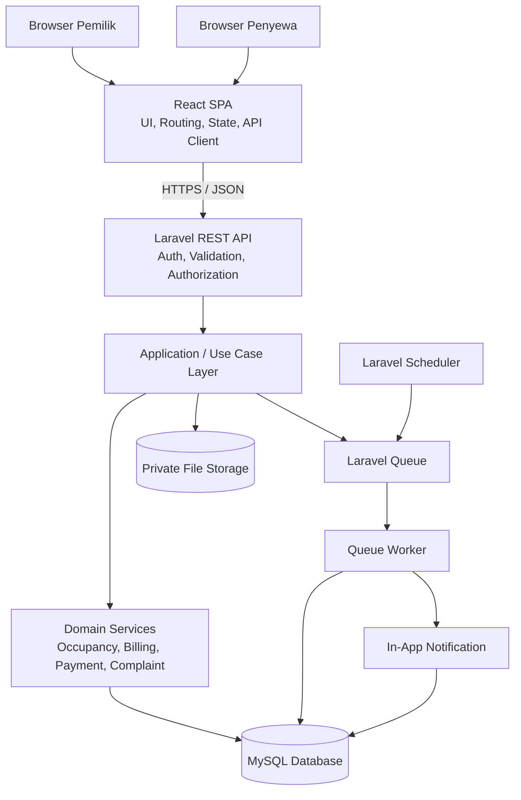

### Penjelasan Komponen

| Komponen | Tanggung jawab |
|---|---|
| React SPA | Menampilkan halaman, form, tabel, navigasi, dan status proses |
| API Client | Mengelola request, response, token/CSRF, dan error |
| Laravel API | Menerima request, autentikasi, validasi, otorisasi, dan response |
| Application Layer | Mengorkestrasi use case, misalnya penempatan penyewa dan verifikasi pembayaran |
| Domain Services | Menjalankan aturan bisnis inti |
| MySQL | Menyimpan data operasional dan histori |
| Private Storage | Menyimpan bukti pembayaran dan foto secara privat |
| Scheduler | Menjadwalkan penerbitan invoice dan pemrosesan tenggat |
| Queue Worker | Menjalankan notifikasi dan pekerjaan asynchronous |
| Notification | Menyimpan notifikasi in-app untuk masing-masing pengguna |

## 2.2 Gaya Arsitektur: Modular Monolith

Untuk MVP, backend dibangun sebagai satu aplikasi Laravel dengan pemisahan modul berdasarkan domain bisnis. Setiap modul memiliki tanggung jawab yang jelas, tetapi tetap berada dalam satu codebase dan satu deployment.

**Alasan pemilihan:**

- Target MVP hanya empat minggu.
- Sistem melayani satu properti dan dua role.
- Tim dapat mengembangkan backend secara paralel tanpa beban infrastruktur microservices.
- Transaksi lintas entitas lebih mudah dijaga menggunakan database transaction.
- Modul dapat dipisahkan menjadi service tersendiri di masa depan jika kebutuhan benar-benar meningkat.

Microservices tidak direkomendasikan untuk MVP karena menambah kebutuhan komunikasi antarservice, observability, deployment, dan konsistensi data.

## 2.3 Batas Kepercayaan

- Browser dan input pengguna dianggap tidak tepercaya.
- Semua validasi penting dilakukan kembali di Laravel.
- Frontend tidak boleh mengirim `user_id` atau `role` untuk menentukan identitas aktor yang sedang login.
- File yang diunggah dianggap tidak tepercaya sampai lolos pemeriksaan.
- File privat tidak dapat diakses hanya dengan mengetahui path penyimpanannya.
- Scheduler dan worker menggunakan konfigurasi serta credential server, bukan credential frontend.

---

# 3. Struktur Modul Sistem

## 3.1 Pemetaan Modul

| Kode | Modul | Tanggung jawab utama | Prioritas |
|---|---|---|---|
| MOD-01 | Authentication & Authorization | Login, logout, session, role, reset password | Must |
| MOD-02 | Property Settings | Informasi kost, rekening, peraturan | Must/Should sesuai PRD |
| MOD-03 | Room Management | Tipe kamar, harga, kamar, fasilitas | Must |
| MOD-04 | Tenant Management | Akun dan profil penyewa | Must |
| MOD-05 | Occupancy Management | Penempatan, pindah, keluar, riwayat hunian | Must |
| MOD-06 | Billing | Periode, invoice, jatuh tempo, pembatalan | Must |
| MOD-07 | Payment | Upload bukti, verifikasi, pembayaran tunai | Must |
| MOD-08 | Deposit | Penerimaan, pengembalian, pemotongan deposit | Must |
| MOD-09 | Complaint | Keluhan, foto, komentar, status, penyelesaian | Must |
| MOD-10 | Notification | Notifikasi in-app dan log pemrosesan | Must |
| MOD-11 | Dashboard & Reporting | Ringkasan operasional, tunggakan, laporan | Must |
| MOD-12 | Audit & History | Riwayat status dan aktivitas penting | Must |
| MOD-13 | Background Processing | Scheduler, queue, retry, job monitoring | Must |

## 3.2 Batas Tanggung Jawab Modul

### Authentication & Authorization
Mengelola identitas pengguna, autentikasi menggunakan nomor HP dan password, penguncian sementara setelah lima kegagalan login berturut-turut selama 15 menit, kewajiban mengganti password sementara, serta pemeriksaan role dan kepemilikan data.

### Property Settings
Menyimpan nama kost, alamat, kontak pengelola, rekening transfer, dan peraturan kost. Perubahan rekening harus tercatat karena informasi ini digunakan pada halaman tagihan.

### Room Management
Mengelola tipe kamar, harga per periode 1/6/12 bulan, data kamar, status perbaikan, fasilitas kamar, fasilitas bersama, serta histori kondisi fasilitas.

### Tenant Management
Mengelola akun dan profil penyewa. Data KTP tidak dikumpulkan pada MVP. Nomor HP harus unik.

### Occupancy Management
Menjadi pusat riwayat hunian. Penempatan, pindah kamar, dan keluar harus dilakukan melalui use case khusus, bukan CRUD bebas pada tabel `occupancies`.

### Billing
Menghitung periode sewa, menentukan snapshot harga, menerbitkan invoice, mengelola status invoice, dan mencegah tagihan ganda.

### Payment
Mencatat percobaan pembayaran transfer atau tunai. Bukti yang ditolak tetap tersimpan sebagai histori. Satu invoice hanya boleh memiliki satu pembayaran sukses.

### Deposit
Mencatat uang deposit masuk dan penyelesaian deposit ketika penyewa keluar. Setiap pemotongan harus memiliki alasan.

### Complaint
Mengelola keluhan, foto, komentar, status, akar masalah, tindakan, dan biaya perbaikan.

### Notification
Membuat notifikasi in-app berdasarkan event bisnis. Kegagalan notifikasi tidak boleh membatalkan transaksi utama.

### Dashboard & Reporting
Menyediakan agregasi data kamar, pembayaran, tunggakan, keluhan, dan biaya perbaikan. Dashboard bukan sumber data transaksi; semua angka dihitung dari tabel sumber.

---

# 4. Rancangan Struktur Backend Laravel

## 4.1 Struktur Direktori yang Disarankan

```text
app/
├── Domain/
│   ├── Identity/
│   │   ├── Actions/
│   │   ├── Policies/
│   │   └── Services/
│   ├── Property/
│   │   ├── Actions/
│   │   ├── Models/
│   │   └── Services/
│   ├── Rooms/
│   │   ├── Actions/
│   │   ├── Models/
│   │   ├── Policies/
│   │   └── Services/
│   ├── Tenants/
│   │   ├── Actions/
│   │   ├── Models/
│   │   └── Services/
│   ├── Occupancies/
│   │   ├── Actions/
│   │   ├── Models/
│   │   ├── Policies/
│   │   └── Services/
│   ├── Billing/
│   │   ├── Actions/
│   │   ├── Jobs/
│   │   ├── Models/
│   │   └── Services/
│   ├── Payments/
│   │   ├── Actions/
│   │   ├── Models/
│   │   └── Services/
│   ├── Deposits/
│   │   ├── Actions/
│   │   ├── Models/
│   │   └── Services/
│   ├── Complaints/
│   │   ├── Actions/
│   │   ├── Jobs/
│   │   ├── Models/
│   │   └── Services/
│   ├── Notifications/
│   │   ├── Jobs/
│   │   ├── Models/
│   │   └── Services/
│   └── Audit/
│       ├── Models/
│       └── Services/
├── Http/
│   ├── Controllers/Api/V1/
│   ├── Middleware/
│   ├── Requests/
│   └── Resources/
├── Jobs/
├── Console/
└── Providers/
```

Struktur tersebut merupakan rekomendasi pengorganisasian. Jika tim belum terbiasa dengan domain folder, implementasi dapat dimulai dengan struktur Laravel standar (`Models`, `Http`, `Services`, `Jobs`) tetapi batas modul dan tanggung jawab tetap dipertahankan.

## 4.2 Pola Request Backend

Alur request standar:

1. Route menerima request.
2. Middleware memeriksa autentikasi dan role.
3. Form Request memvalidasi input.
4. Controller memanggil Action/Use Case.
5. Action menjalankan domain service dan transaksi database jika dibutuhkan.
6. Model/repository mengakses database.
7. Event dicatat atau job dimasukkan ke queue setelah transaksi berhasil.
8. API Resource membentuk response JSON.

Controller tidak boleh berisi seluruh perhitungan periode, status invoice, dan aturan perpindahan hunian.

## 4.3 Komponen Teknis

| Komponen | Tanggung jawab |
|---|---|
| Controller | Adapter HTTP, tidak memuat aturan bisnis kompleks |
| Form Request | Validasi bentuk dan format input |
| Policy | Otorisasi berbasis aktor dan kepemilikan resource |
| Action / Use Case | Mengorkestrasi satu operasi bisnis |
| Domain Service | Perhitungan dan aturan bisnis |
| Model | Relasi dan representasi data |
| API Resource | Format response konsisten |
| Job | Pekerjaan asynchronous |
| Event/Listener | Memisahkan perubahan domain dari efek samping seperti notifikasi |
| Scheduler | Menjalankan proses berdasarkan waktu |

## 4.4 Contoh Use Case

| Use case | Action yang disarankan |
|---|---|
| Menempatkan penyewa | `CreateOccupancyAction` |
| Pindah kamar | `TransferOccupancyAction` |
| Mengakhiri hunian | `EndOccupancyAction` |
| Menerbitkan invoice | `IssueInvoiceAction` |
| Membatalkan invoice | `CancelInvoiceAction` |
| Mengunggah bukti | `SubmitPaymentProofAction` |
| Verifikasi pembayaran | `VerifyPaymentAction` |
| Mencatat pembayaran tunai | `RecordCashPaymentAction` |
| Menyelesaikan deposit | `SettleDepositAction` |
| Mengubah status keluhan | `TransitionComplaintStatusAction` |

---

# 5. Rancangan Frontend React

## 5.1 Struktur Direktori

```text
src/
├── app/
│   ├── router/
│   ├── providers/
│   └── layouts/
├── components/
│   ├── ui/
│   ├── forms/
│   ├── tables/
│   └── feedback/
├── features/
│   ├── auth/
│   ├── dashboard/
│   ├── rooms/
│   ├── tenants/
│   ├── occupancies/
│   ├── invoices/
│   ├── payments/
│   ├── deposits/
│   ├── complaints/
│   ├── notifications/
│   ├── reports/
│   └── settings/
├── lib/
│   ├── api-client.ts
│   ├── formatters.ts
│   └── validators.ts
├── hooks/
├── types/
└── main.tsx
```

## 5.2 Pemisahan Area Pengguna

| Area | Route contoh | Akses |
|---|---|---|
| Login | `/login` | Guest |
| Dashboard pemilik | `/owner/dashboard` | Pemilik |
| Kamar | `/owner/rooms` | Pemilik |
| Tipe kamar | `/owner/room-types` | Pemilik |
| Penyewa | `/owner/tenants` | Pemilik |
| Hunian | `/owner/occupancies` | Pemilik |
| Tagihan | `/owner/invoices` | Pemilik |
| Verifikasi pembayaran | `/owner/payments/pending` | Pemilik |
| Keluhan | `/owner/complaints` | Pemilik |
| Laporan | `/owner/reports` | Pemilik |
| Pengaturan | `/owner/settings` | Pemilik |
| Dashboard penyewa | `/tenant/dashboard` | Penyewa |
| Kamar saya | `/tenant/my-room` | Penyewa |
| Tagihan saya | `/tenant/invoices` | Penyewa |
| Keluhan saya | `/tenant/complaints` | Penyewa |
| Profil | `/profile` | Semua role sesuai policy |

Route guard frontend hanya untuk pengalaman navigasi. Backend tetap wajib memeriksa hak akses.

## 5.3 Pengelolaan State

Pisahkan state menjadi:

- **Server state:** data kamar, invoice, pembayaran, keluhan. Gunakan cache/query layer seperti TanStack Query atau pola fetch terpusat.
- **UI state:** modal terbuka, tab aktif, filter sementara.
- **Form state:** nilai input dan error validasi.
- **Authentication state:** identitas user, role, status wajib ganti password.

Hindari menyimpan salinan data transaksi yang mudah kedaluwarsa di banyak komponen. Setelah mutasi berhasil, invalidasi atau perbarui cache terkait.

## 5.4 Komponen UI Reusable

- `StatusBadge`
- `ConfirmDialog`
- `DataTable`
- `Pagination`
- `FileUploader`
- `MoneyInput`
- `DateInput`
- `EmptyState`
- `ErrorState`
- `LoadingState`
- `NotificationDropdown`
- `InvoiceSummary`
- `PaymentProofPreview`
- `ComplaintTimeline`

## 5.5 Aturan UX Teknis

- Form menampilkan error dari API sesuai field.
- Tombol submit dinonaktifkan selama request berlangsung untuk mencegah klik berulang.
- Operasi penting memerlukan konfirmasi.
- Status ditampilkan dengan teks, bukan warna saja.
- Halaman penyewa dioptimalkan untuk lebar layar minimal 360 px.
- Bukti pembayaran dan foto keluhan ditampilkan melalui endpoint privat yang terotorisasi.

---

# 6. Rancangan Database

## 6.1 Konvensi Database

- Database: MySQL dengan InnoDB.
- Encoding: `utf8mb4`.
- Primary key: `BIGINT UNSIGNED` atau UUID/ULID jika disepakati tim. Untuk MVP, BIGINT lebih sederhana.
- Nominal: `BIGINT` untuk Rupiah bulat, tidak menggunakan floating point.
- Tanggal bisnis: `DATE` jika hanya tanggal; timestamp disimpan konsisten dalam UTC atau strategi timezone yang disepakati. Tampilan dan scheduler menggunakan `Asia/Jakarta`.
- Semua tabel transaksional memiliki `created_at` dan `updated_at` jika relevan.
- Gunakan foreign key dan index untuk relasi yang sering diakses.
- Gunakan soft delete hanya pada data master yang memang perlu dinonaktifkan. Jangan soft-delete transaksi untuk menyembunyikan histori.

## 6.2 ERD Konseptual

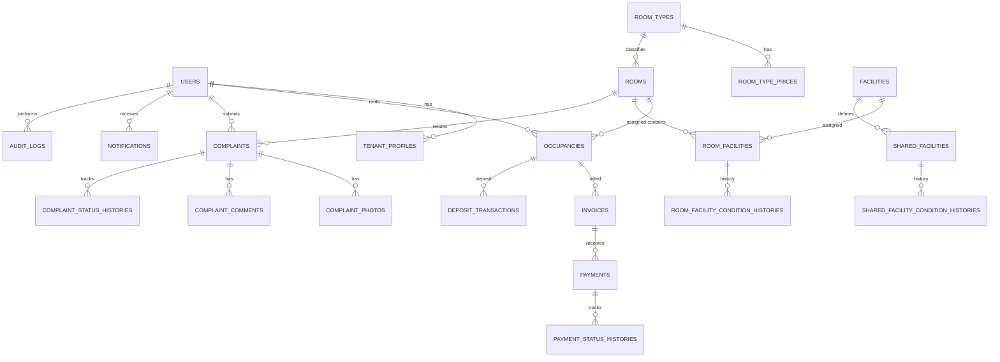

## 6.3 Rancangan Tabel

### A. Identitas

#### `users`

| Kolom | Tipe usulan | Aturan |
|---|---|---|
| id | BIGINT PK | Auto increment |
| role | VARCHAR(20) | `owner` / `tenant` |
| name | VARCHAR(150) | Required |
| phone | VARCHAR(20) | Unique |
| password | VARCHAR(255) | Hash |
| photo_path | VARCHAR(255) nullable | Path privat jika diperlukan |
| is_active | BOOLEAN | Default true |
| must_change_password | BOOLEAN | Default false |
| failed_login_attempts | SMALLINT | Default 0 |
| locked_until | DATETIME nullable | Lockout sementara |
| consented_at | DATETIME nullable | Waktu persetujuan |
| consent_version | VARCHAR(30) nullable | Versi informasi persetujuan |
| created_at / updated_at | TIMESTAMP | Laravel timestamps |

#### `tenant_profiles`

| Kolom | Tipe usulan | Aturan |
|---|---|---|
| id | BIGINT PK | |
| user_id | BIGINT FK | Unique, relasi users |
| occupation | VARCHAR(120) nullable | |
| emergency_name | VARCHAR(150) nullable | |
| emergency_relation | VARCHAR(80) nullable | |
| emergency_phone | VARCHAR(20) nullable | |

### B. Kamar dan Fasilitas

#### `room_types`
`id`, `name`, `description`, `created_at`, `updated_at`.

#### `room_type_prices`

| Kolom | Tipe usulan | Aturan |
|---|---|---|
| id | BIGINT PK | |
| room_type_id | BIGINT FK | |
| period_months | TINYINT | Hanya 1, 6, 12 |
| price | BIGINT | Rupiah, positif |
| effective_from | DATE | Awal berlaku |
| effective_until | DATE nullable | Akhir berlaku |

Index yang disarankan: `(room_type_id, period_months, effective_from)`. Cegah periode harga yang tumpang tindih melalui validasi service dan transaksi.

#### `rooms`
`id`, `number` (unique), `floor`, `room_type_id` FK, `maintenance_status`, timestamps.

`maintenance_status` minimal: `normal`, `maintenance`. Status terisi/kosong ditentukan dari occupancy aktif dan maintenance status, bukan dari input bebas pengguna.

#### `facilities`
`id`, `name`, `scope` (`room` / `shared`), timestamps.

#### `room_facilities`
`id`, `room_id` FK, `facility_id` FK, `condition_status`, `note`, timestamps. Unique gabungan `(room_id, facility_id)` jika satu fasilitas hanya boleh tercatat sekali pada satu kamar.

#### `room_facility_condition_histories`
`id`, `room_facility_id` FK, `condition_status`, `photo_path`, `note`, `recorded_at`, `recorded_by` FK users.

#### `shared_facilities`
`id`, `facility_id` FK, `name`, `is_active`, timestamps.

#### `shared_facility_condition_histories`
`id`, `shared_facility_id` FK, `condition_status`, `photo_path`, `note`, `recorded_at`, `recorded_by` FK users.

### C. Hunian, Tagihan, Pembayaran, Deposit

#### `occupancies`

| Kolom | Tipe usulan | Aturan |
|---|---|---|
| id | BIGINT PK | |
| user_id | BIGINT FK | Penyewa |
| room_id | BIGINT FK | Kamar |
| start_date | DATE | Required |
| end_date | DATE nullable | Null saat aktif |
| anchor_day | TINYINT | Hari anchor siklus, 1–31 |
| next_period_months | TINYINT | 1, 6, 12 |
| deposit_amount | BIGINT | Snapshot nominal deposit awal |
| status | VARCHAR(20) | `active`, `moved`, `ended` |
| created_at / updated_at | TIMESTAMP | |

Index: `(room_id, status)`, `(user_id, status)`. Aturan satu occupancy aktif per kamar harus ditegakkan melalui transaksi dan locking. Unique partial index tidak tersedia secara seragam pada semua versi MySQL; jangan mengandalkan validasi frontend.

#### `invoices`

| Kolom | Tipe usulan | Aturan |
|---|---|---|
| id | BIGINT PK | |
| number | VARCHAR(50) | Unique |
| occupancy_id | BIGINT FK | Wajib |
| period_start | DATE | Awal periode |
| period_end | DATE | Akhir periode |
| period_months | TINYINT | 1, 6, 12 |
| amount | BIGINT | Snapshot harga |
| due_date | DATE | Jatuh tempo |
| status | VARCHAR(30) | Status invoice |
| cancel_reason | TEXT nullable | Wajib jika batal |
| replaces_invoice_id | BIGINT nullable FK invoices | Invoice yang digantikan |
| created_at / updated_at | TIMESTAMP | |

Unique key yang disarankan: `(occupancy_id, period_start, period_end)` agar invoice periode yang sama tidak terbit dua kali. Pastikan definisi periode tidak berubah-ubah.

#### `payments`

| Kolom | Tipe usulan | Aturan |
|---|---|---|
| id | BIGINT PK | |
| invoice_id | BIGINT FK | |
| method | VARCHAR(20) | `transfer` / `cash` |
| amount | BIGINT | Harus sama dengan jumlah pelunasan |
| paid_at | DATETIME | Tanggal pembayaran menurut input |
| proof_path | VARCHAR(255) nullable | Transfer |
| status | VARCHAR(30) | `pending`, `verified`, `rejected` |
| reject_reason | TEXT nullable | Wajib saat ditolak |
| verified_by | BIGINT nullable FK users | Pemilik |
| verified_at | DATETIME nullable | |
| created_at / updated_at | TIMESTAMP | |

Satu invoice dapat memiliki beberapa payment attempt karena bukti dapat ditolak. Buat aturan hanya satu payment `verified` per invoice melalui transaksi dan locking; bila versi MySQL mendukung desain indeks yang tepat, constraint tambahan dapat digunakan.

#### `payment_status_histories`
`id`, `payment_id` FK, `old_status`, `new_status`, `changed_by` FK users nullable untuk proses sistem, `reason`, `created_at`.

#### `deposit_transactions`

| Kolom | Tipe usulan | Aturan |
|---|---|---|
| id | BIGINT PK | |
| occupancy_id | BIGINT FK | |
| transaction_type | VARCHAR(30) | `received`, `refunded`, `deducted`, `forfeited` |
| amount | BIGINT | Positif |
| reason | TEXT nullable | Wajib untuk pemotongan/penyelesaian |
| transaction_date | DATE | |
| recorded_by | BIGINT FK users | Pemilik |
| created_at | TIMESTAMP | |

Saldo deposit dihitung dari transaksi deposit, bukan diedit langsung tanpa histori.

### D. Keluhan dan Notifikasi

#### `complaints`
`id`, `user_id` FK, `room_id` FK, `facility_id` nullable FK, `category`, `urgency`, `title`, `description`, `status`, `root_cause_category` nullable, `root_cause_note` nullable, `action_taken` nullable, `repair_cost` nullable BIGINT, `resolved_at` nullable, `confirmed_at` nullable, timestamps.

#### `complaint_photos`
`id`, `complaint_id` FK, `path`, `created_at`.

#### `complaint_comments`
`id`, `complaint_id` FK, `user_id` FK, `body`, `photo_path` nullable, timestamps.

#### `complaint_status_histories`
`id`, `complaint_id` FK, `old_status`, `new_status`, `changed_by` FK users nullable, `note`, `created_at`.

#### `notifications`
`id`, `user_id` FK, `type`, `title`, `body`, `read_at` nullable, `related_type` nullable, `related_id` nullable, timestamps.

#### `notification_logs`
`id`, `notification_id` FK, `channel`, `status`, `attempts`, `last_attempt_at`, `error_message`, timestamps.

### E. Audit dan Pengaturan

#### `audit_logs`
`id`, `actor_id` nullable FK users, `entity_type`, `entity_id`, `action`, `old_values` JSON nullable, `new_values` JSON nullable, `created_at`.

Audit log sebaiknya append-only dari aplikasi. Jangan simpan password, token, atau data rahasia dalam `old_values`/`new_values`.

#### `settings`
`id`, `setting_key` unique, `setting_value` JSON/TEXT, timestamps. Akses hanya pemilik.

## 6.4 Relasi Kunci

1. `users` 1:N `occupancies`.
2. `rooms` 1:N `occupancies`.
3. `occupancies` 1:N `invoices`.
4. `invoices` 1:N `payments`.
5. `payments` 1:N `payment_status_histories`.
6. `occupancies` 1:N `deposit_transactions`.
7. `users` 1:N `complaints`.
8. `complaints` 1:N `complaint_photos`, `complaint_comments`, dan `complaint_status_histories`.
9. `users` 1:N `notifications`.
10. `users` 1:N `audit_logs` sebagai aktor.

## 6.5 Aturan Integritas Database

- Nomor HP unik.
- Nomor kamar unik.
- Periode harga tidak boleh tumpang tindih untuk tipe kamar dan periode yang sama.
- Kamar tidak boleh mempunyai lebih dari satu occupancy aktif.
- Invoice tidak boleh duplikat untuk occupancy dan rentang periode yang sama.
- Invoice menyimpan snapshot harga dan periode.
- Pembayaran terverifikasi tidak boleh dihapus melalui operasi normal.
- Pembatalan invoice membutuhkan alasan dan tidak menghapus invoice lama.
- Foreign key memakai kebijakan restrict/no action untuk transaksi historis agar tidak terhapus berantai.
- Operasi multi-tabel menggunakan database transaction.
- Data histori dan audit tidak dapat diubah oleh penyewa.

## 6.6 Catatan Keputusan Skema

PRD menyebut `room_facility_condition_histories`, `shared_facilities`, `shared_facility_condition_histories`, `payment_status_histories`, `deposit_transactions`, `complaint_status_histories`, `notification_logs`, dan `audit_logs`. Tabel tersebut dipertahankan pada desain agar histori tidak hanya disimpan sebagai kolom status terkini.

---

# 7. State Machine dan Aturan Transisi

## 7.1 Status Occupancy

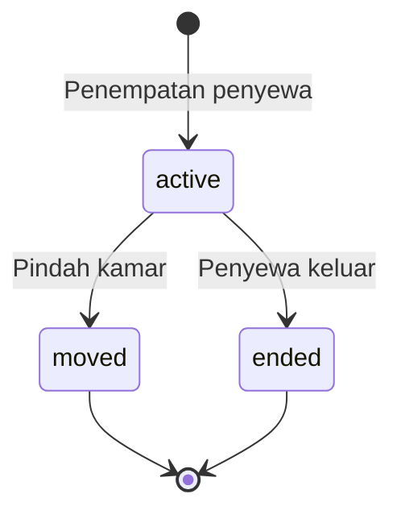

Catatan:
- Pindah kamar menutup occupancy lama dengan status `moved`, lalu membuat occupancy baru `active`.
- Keluar mengubah occupancy menjadi `ended` dan mengisi `end_date`.
- Occupancy historis tidak dihapus.
- Perubahan status dilakukan oleh use case khusus pemilik.

## 7.2 Status Invoice

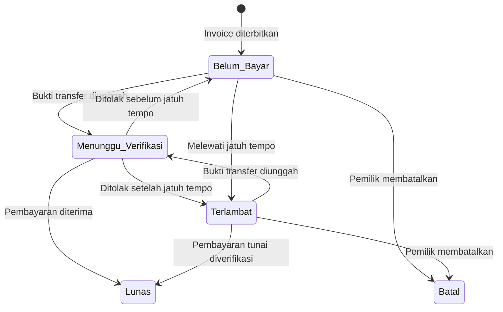

Ketentuan:
- Invoice `Lunas` tidak kembali ke status belum bayar melalui operasi normal.
- Invoice `Batal` tidak dapat dibayar.
- Koreksi setelah invoice terbit menggunakan pembatalan dan invoice pengganti.
- Pengingat ditahan saat `Menunggu Verifikasi`.
- Pembayaran penuh saja untuk MVP.

## 7.3 Status Payment

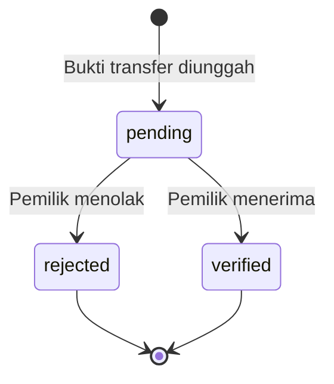

Pembayaran tunai dapat dibuat langsung sebagai `verified` setelah pemilik mencatat dan mengonfirmasi penerimaan. Tetap simpan aktor dan waktu pencatatan.

## 7.4 Status Complaint

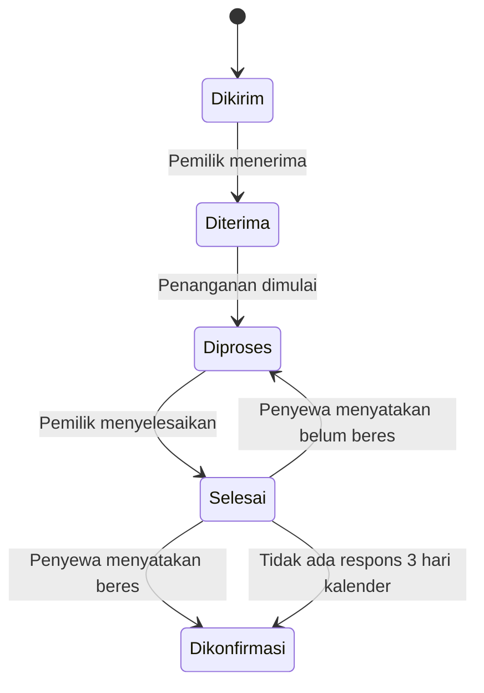

Setiap transisi harus memeriksa status awal, role aktor, dan hak akses. Semua perubahan dicatat pada `complaint_status_histories`.

---

# 8. Rancangan Alur Proses Kritis

## 8.1 Penempatan Penyewa

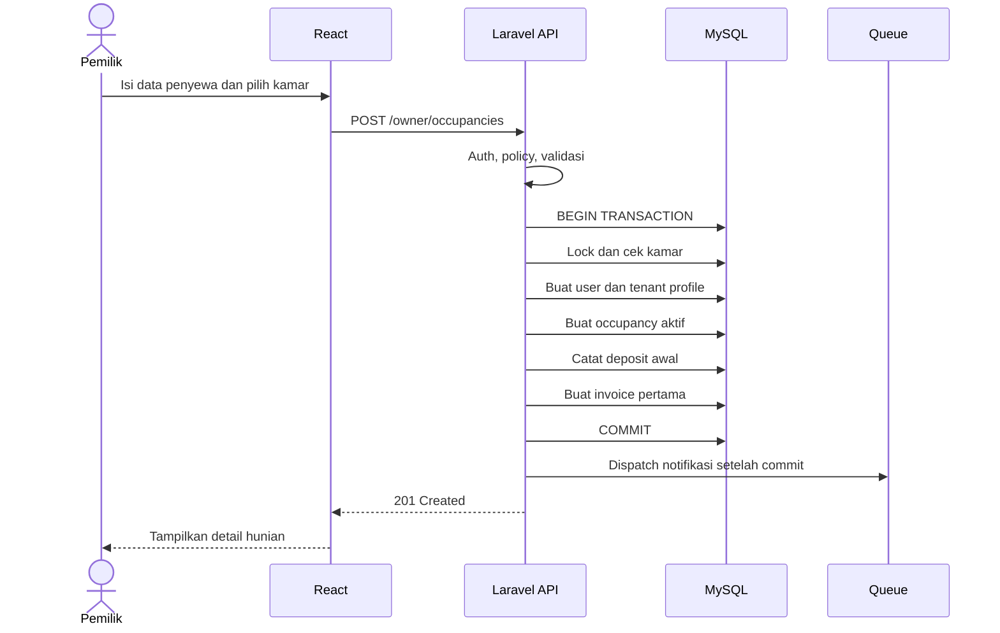

**Ketentuan implementasi:**
- Gunakan `DB::transaction()`.
- Kunci baris kamar dengan `lockForUpdate()` saat memeriksa dan membuat occupancy.
- Validasi tidak ada occupancy aktif pada kamar tujuan.
- Jika pembuatan invoice pertama gagal, seluruh transaksi inti dibatalkan.
- Pengiriman notifikasi dilakukan setelah commit agar tidak mengirim notifikasi untuk data yang gagal tersimpan.

## 8.2 Pindah Kamar

1. Pemilik memilih occupancy aktif dan kamar tujuan.
2. Backend memvalidasi kamar tujuan.
3. Backend mengunci kamar asal, kamar tujuan, dan occupancy terkait sesuai urutan konsisten.
4. Tutup occupancy lama (`moved`) dengan tanggal akhir yang sesuai.
5. Buat occupancy baru untuk kamar tujuan.
6. Simpan catatan perpindahan.
7. Invoice lama tetap terkait occupancy lama dan tidak diubah.
8. Commit transaksi.
9. Notifikasi dibuat setelah transaksi berhasil.

Perhitungan prorata atau selisih harga tidak dilakukan otomatis sebelum keputusan stakeholder disepakati.

## 8.3 Penerbitan Invoice Terjadwal

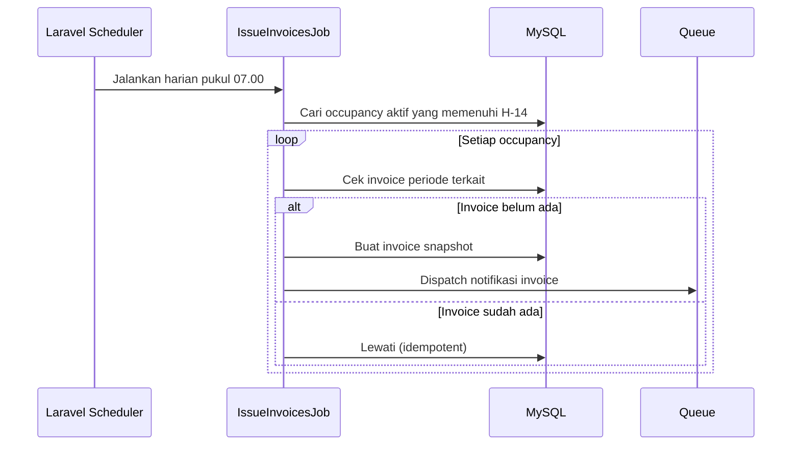

Aturan teknis:
- Gunakan unique key pada kombinasi occupancy dan periode invoice.
- Scheduler boleh dijalankan ulang.
- Job tidak boleh membuat invoice ganda.
- Kegagalan satu occupancy tidak boleh menghentikan pemrosesan seluruh occupancy.
- Catat kegagalan agar dapat diperiksa dan diproses ulang.
- Perhitungan tanggal menggunakan anchor day untuk menghindari pergeseran permanen tanggal 29–31.

## 8.4 Upload dan Verifikasi Pembayaran

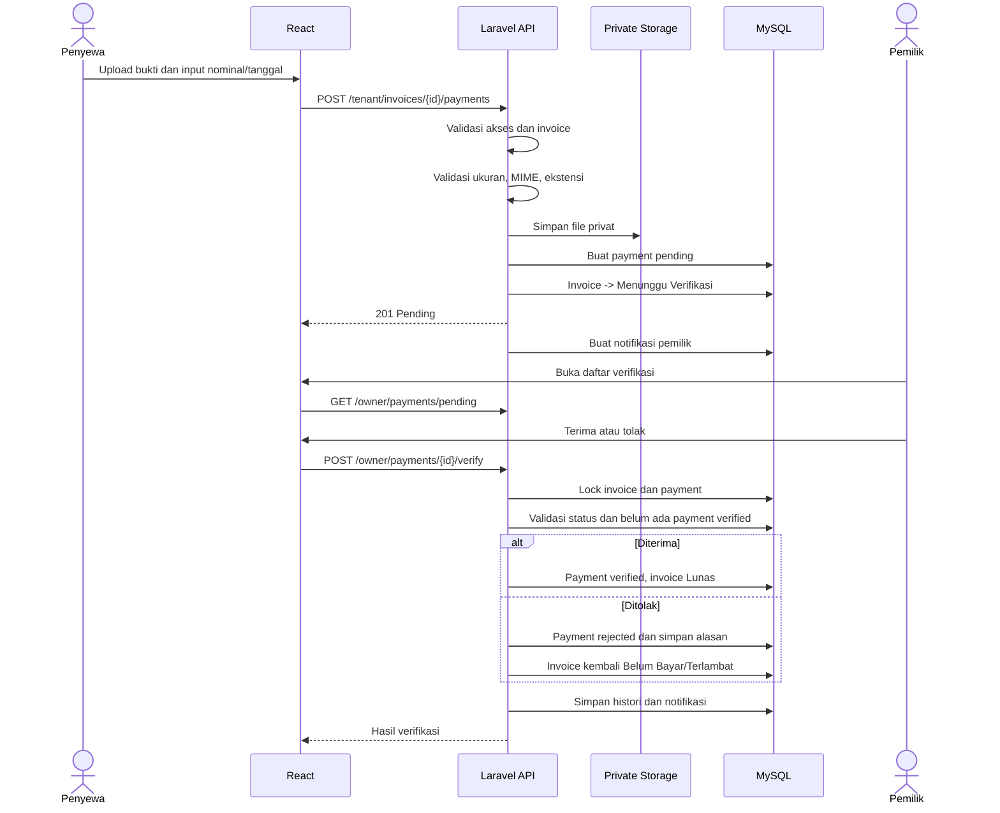

**Aturan keamanan dan konsistensi:**
- Penyewa hanya dapat mengunggah bukti untuk invoice miliknya.
- File disimpan privat.
- Nominal harus sesuai dengan nilai invoice untuk pembayaran penuh.
- Pemilik memeriksa bukti secara manual.
- Saat verifikasi, lock invoice untuk mencegah dua verifikasi bersamaan.
- Hanya satu payment yang boleh `verified`.
- Jika ditolak, alasan wajib disimpan.
- Bukti lama tidak dihapus saat penyewa mengunggah ulang.

## 8.5 Pembayaran Tunai

1. Pemilik membuka invoice belum lunas.
2. Memasukkan nominal dan tanggal diterima.
3. Backend memeriksa nominal sama dengan total invoice.
4. Backend mengunci invoice.
5. Membuat payment dengan method `cash` dan status `verified`.
6. Mengubah invoice menjadi `Lunas`.
7. Menyimpan pemilik pencatat, waktu, dan histori.
8. Membuat notifikasi penyewa setelah transaksi berhasil.

## 8.6 Penyelesaian Keluhan

1. Penyewa mengirim keluhan beserta 1–3 foto.
2. Backend memvalidasi kepemilikan kamar/occupancy dan file.
3. Keluhan dibuat dengan status `Dikirim`.
4. Pemilik menerima notifikasi.
5. Pemilik mengubah status menjadi `Diterima`, lalu `Diproses`.
6. Saat selesai, pemilik wajib mengisi akar masalah, tindakan, dan biaya.
7. Status menjadi `Selesai`, `resolved_at` diisi.
8. Penyewa mengonfirmasi atau menyatakan belum selesai.
9. Jika tidak ada respons selama tiga hari kalender, job mengubah status menjadi `Dikonfirmasi`.
10. Semua transisi disimpan pada histori.

---

# 9. Rancangan API

## 9.1 Standar API

Base URL: `/api/v1`

Format request/response: JSON, kecuali upload file menggunakan `multipart/form-data`.

### Response sukses

```json
{
  "data": {},
  "meta": {}
}
```

### Response validasi

```json
{
  "message": "Data yang diberikan tidak valid.",
  "errors": {
    "phone": ["Nomor HP sudah digunakan."]
  }
}
```

### Response error umum

```json
{
  "message": "Anda tidak memiliki akses untuk melakukan tindakan ini.",
  "code": "FORBIDDEN"
}
```

Gunakan HTTP status yang konsisten:

| Status | Makna |
|---|---|
| 200 | Berhasil |
| 201 | Resource berhasil dibuat |
| 204 | Berhasil tanpa response body |
| 401 | Belum terautentikasi |
| 403 | Tidak memiliki hak akses |
| 404 | Resource tidak ditemukan atau tidak dapat diakses |
| 409 | Konflik status atau data |
| 422 | Validasi gagal |
| 429 | Rate limit |
| 500 | Kesalahan internal |

## 9.2 Daftar Endpoint

### Authentication

| Method | Endpoint | Akses | Fungsi |
|---|---|---|---|
| POST | `/auth/login` | Guest | Login nomor HP dan password |
| POST | `/auth/logout` | Auth | Logout |
| GET | `/auth/me` | Auth | Profil user aktif |
| POST | `/auth/change-password` | Auth | Ganti password |
| POST | `/owner/tenants/{id}/reset-password` | Owner | Reset password penyewa |

### Property Settings

| Method | Endpoint | Akses | Fungsi |
|---|---|---|---|
| GET | `/owner/settings` | Owner | Lihat pengaturan |
| PUT | `/owner/settings` | Owner | Perbarui pengaturan |

### Room Management

| Method | Endpoint | Akses | Fungsi |
|---|---|---|---|
| GET | `/owner/room-types` | Owner | Daftar tipe kamar |
| POST | `/owner/room-types` | Owner | Buat tipe kamar |
| PUT | `/owner/room-types/{id}` | Owner | Ubah tipe kamar |
| GET | `/owner/rooms` | Owner | Daftar kamar |
| POST | `/owner/rooms` | Owner | Buat kamar |
| GET | `/owner/rooms/{id}` | Owner | Detail kamar |
| PUT | `/owner/rooms/{id}` | Owner | Ubah data kamar |
| PATCH | `/owner/rooms/{id}/maintenance` | Owner | Ubah status perbaikan |
| GET | `/owner/facilities` | Owner | Daftar fasilitas |
| POST | `/owner/facilities` | Owner | Buat fasilitas |

### Tenant & Occupancy

| Method | Endpoint | Akses | Fungsi |
|---|---|---|---|
| GET | `/owner/tenants` | Owner | Daftar penyewa |
| POST | `/owner/tenants` | Owner | Buat akun penyewa |
| GET | `/owner/tenants/{id}` | Owner | Detail penyewa |
| PUT | `/owner/tenants/{id}` | Owner | Ubah profil penyewa |
| GET | `/owner/occupancies` | Owner | Daftar hunian |
| POST | `/owner/occupancies` | Owner | Penempatan penyewa |
| POST | `/owner/occupancies/{id}/transfer` | Owner | Pindah kamar |
| POST | `/owner/occupancies/{id}/end` | Owner | Akhiri hunian |
| GET | `/owner/tenants/{id}/history` | Owner | Riwayat penyewa |
| GET | `/tenant/my-room` | Tenant | Kamar yang ditempati |

### Billing & Payment

| Method | Endpoint | Akses | Fungsi |
|---|---|---|---|
| GET | `/owner/invoices` | Owner | Daftar invoice |
| GET | `/owner/invoices/{id}` | Owner | Detail invoice |
| POST | `/owner/invoices/{id}/cancel` | Owner | Batalkan invoice |
| POST | `/owner/invoices/{id}/reissue` | Owner | Terbitkan invoice pengganti |
| GET | `/tenant/invoices` | Tenant | Daftar invoice sendiri |
| GET | `/tenant/invoices/{id}` | Tenant | Detail invoice sendiri |
| POST | `/tenant/invoices/{id}/period-selection` | Tenant | Pilih periode berikutnya |
| POST | `/tenant/invoices/{id}/payments` | Tenant | Upload bukti transfer |
| GET | `/owner/payments/pending` | Owner | Daftar verifikasi |
| POST | `/owner/payments/{id}/verify` | Owner | Terima/tolak bukti |
| POST | `/owner/invoices/{id}/cash-payment` | Owner | Catat pembayaran tunai |
| GET | `/tenant/payments/{id}` | Tenant pemilik data | Detail pembayaran sendiri |

### Deposit

| Method | Endpoint | Akses | Fungsi |
|---|---|---|---|
| GET | `/owner/occupancies/{id}/deposits` | Owner | Riwayat deposit |
| POST | `/owner/occupancies/{id}/deposits` | Owner | Catat transaksi deposit |

### Complaint

| Method | Endpoint | Akses | Fungsi |
|---|---|---|---|
| GET | `/owner/complaints` | Owner | Semua keluhan |
| GET | `/tenant/complaints` | Tenant | Keluhan sendiri |
| POST | `/tenant/complaints` | Tenant | Buat keluhan |
| GET | `/complaints/{id}` | Owner/tenant terkait | Detail sesuai policy |
| POST | `/complaints/{id}/transition` | Owner/tenant sesuai status | Transisi status |
| POST | `/complaints/{id}/comments` | Owner/tenant terkait | Tambah komentar |

### Dashboard, Notification, Report

| Method | Endpoint | Akses | Fungsi |
|---|---|---|---|
| GET | `/owner/dashboard` | Owner | Ringkasan operasional |
| GET | `/owner/reports/payments` | Owner | Laporan pembayaran |
| GET | `/owner/reports/arrears` | Owner | Laporan tunggakan |
| GET | `/owner/reports/repairs` | Owner | Biaya perbaikan |
| GET | `/notifications` | Auth | Daftar notifikasi sendiri |
| PATCH | `/notifications/{id}/read` | Auth pemilik notifikasi | Tandai dibaca |
| PATCH | `/notifications/read-all` | Auth | Tandai semua dibaca |

Endpoint di atas adalah rancangan kontrak awal. Nama dan payload final harus disepakati frontend-backend sebelum implementasi paralel.

## 9.3 Contoh Payload Penting

### Penempatan penyewa

```json
{
  "name": "Nama Penyewa",
  "phone": "08xxxxxxxxxx",
  "occupation": "Mahasiswa",
  "emergency_contact": {
    "name": "Nama Kontak",
    "relation": "Orang tua",
    "phone": "08xxxxxxxxxx"
  },
  "room_id": 12,
  "start_date": "2026-12-01",
  "period_months": 1,
  "deposit_amount": 500000
}
```

`user_id`, `role`, dan status occupancy tidak boleh dipercaya dari input frontend. Backend membuat dan menentukan nilai tersebut.

### Upload bukti pembayaran

`multipart/form-data`:

- `amount`: nominal pembayaran.
- `paid_at`: tanggal/waktu transfer.
- `proof`: file JPG, PNG, atau PDF maksimal 5 MB.

### Verifikasi pembayaran

```json
{
  "decision": "reject",
  "reason": "Nominal pada bukti tidak sesuai dengan tagihan."
}
```

Untuk menerima pembayaran, `decision` bernilai `accept`. `reason` wajib saat menolak.

### Transisi keluhan

```json
{
  "action": "resolve",
  "root_cause_category": "wear_and_tear",
  "root_cause_note": "Komponen telah aus karena pemakaian.",
  "action_taken": "Komponen diganti.",
  "repair_cost": 150000
}
```

Backend memetakan action ke transisi status yang sah. Frontend tidak mengirim status arbitrer.

## 9.4 Pagination dan Filter

Endpoint daftar sebaiknya mendukung:

- `page`
- `per_page` dengan batas maksimum
- `search`
- `status`
- `from`
- `to`
- `sort_by`
- `sort_direction`

Validasi nama kolom sorting dilakukan dengan allowlist, bukan meneruskan input bebas ke query SQL.

---

# 10. Autentikasi, Otorisasi, dan Keamanan

## 10.1 Autentikasi

PRD menetapkan login nomor HP dan password serta Laravel Sanctum.

Untuk React SPA yang berada pada domain yang sesuai, gunakan pola autentikasi stateful Sanctum dengan cookie/session dan proteksi CSRF. Jika deployment lintas domain tidak memungkinkan pola tersebut, evaluasi konfigurasi Sanctum yang sesuai sebelum memutuskan token. Jangan menyimpan token sensitif di `localStorage` tanpa analisis risiko.

Alur:
1. React meminta CSRF cookie.
2. User mengirim nomor HP dan password.
3. Laravel memverifikasi credential.
4. Laravel memeriksa `is_active`, lockout, dan `must_change_password`.
5. Session/token dibuat sesuai konfigurasi.
6. Frontend mengambil `/auth/me`.
7. Backend memeriksa role pada setiap endpoint.

## 10.2 Lockout Login

- Setelah lima kegagalan berturut-turut, akun dikunci sementara 15 menit.
- Percobaan dan waktu lockout dikelola backend.
- Pesan error tidak boleh mengungkap apakah nomor HP terdaftar.
- Rate limiting juga diterapkan berdasarkan IP dan/atau identifier untuk mengurangi brute force.
- Reset counter dilakukan sesuai kebijakan setelah login berhasil atau periode lockout berakhir.

## 10.3 Matriks Otorisasi

| Resource/aksi | Pemilik | Penyewa |
|---|---|---|
| Semua kamar | Read/Write | Tidak |
| Profil penyewa | Read/Write | Profil sendiri terbatas |
| Occupancy | Read/Write | Read milik sendiri secara terbatas |
| Invoice | Semua | Milik occupancy sendiri |
| Payment | Semua | Milik invoice sendiri |
| Bukti transfer | Semua sesuai tugas | Milik sendiri |
| Keluhan | Semua | Keluhan sendiri |
| Notifikasi | Milik sendiri | Milik sendiri |
| Pengaturan kost | Read/Write | Read informasi yang boleh ditampilkan |
| Audit log | Read sesuai kebutuhan | Tidak |

Setiap query penyewa harus dibatasi berdasarkan user yang sedang login dan relasi occupancy. Jangan hanya mengandalkan ID yang dikirim client.

## 10.4 Keamanan File

- Maksimal 5 MB untuk bukti pembayaran dan setiap foto keluhan.
- Validasi ekstensi, MIME type, dan isi file bila memungkinkan.
- Nama file dibuat acak oleh server.
- Simpan di private disk/bucket.
- Jangan menerima path file dari client sebagai referensi bebas.
- Akses file melalui controller yang memeriksa policy atau signed URL singkat.
- Kompres foto di server.
- Jangan mengeksekusi file upload.
- Pertimbangkan antivirus scanning jika tersedia dan relevan.

## 10.5 Keamanan Aplikasi

- HTTPS wajib.
- Password di-hash dengan algoritma yang direkomendasikan framework.
- CSRF aktif untuk pola cookie-based SPA.
- CORS dibatasi ke origin frontend.
- Rate limit login, upload, dan endpoint sensitif.
- Validasi server-side untuk semua input.
- Query menggunakan parameter binding/Eloquent.
- Secret disimpan di environment, tidak di repository.
- Log tidak boleh memuat password, token, atau isi dokumen sensitif.
- Error produksi tidak menampilkan stack trace.
- Audit perubahan penting.

## 10.6 Privasi

Kumpulkan data minimum yang diperlukan. KTP tidak diminta pada MVP. Informasi tujuan pemrosesan data ditampilkan kepada penyewa dan waktu serta versi persetujuan dicatat. Kebijakan retensi dan penghapusan harus mengikuti keputusan stakeholder dan ketentuan yang berlaku. Data transaksi tidak boleh hilang hanya karena akun penyewa dinonaktifkan.

---

# 11. Scheduler, Queue, dan Notifikasi

## 11.1 Scheduler

Jadwal inti mengikuti PRD dan timezone `Asia/Jakarta`.

| Waktu relatif | Proses |
|---|---|
| H-21 | Pengingat memilih periode pembayaran |
| H-14 | Penerbitan invoice |
| H-7 | Pengingat jatuh tempo |
| H-3 | Pengingat jatuh tempo |
| H-0 | Pengingat jatuh tempo |
| H+1 dan setiap 3 hari | Notifikasi keterlambatan |
| Setiap hari | Auto-konfirmasi keluhan setelah 3 hari tanpa respons |
| Setiap hari | Pemeriksaan job gagal dan data terjadwal yang tertinggal |

Scheduler berjalan setiap hari pukul 07.00 WIB sesuai PRD. Implementasi dapat memakai `schedule:run` setiap menit dengan task yang dijadwalkan pada 07.00, atau pendekatan scheduler server yang setara. Pastikan timezone aplikasi dan scheduler konsisten.

## 11.2 Queue

Gunakan queue untuk:
- Membuat notifikasi setelah transaksi.
- Mengirim notifikasi batch.
- Memproses foto atau dokumen bila membutuhkan waktu.
- Membuat ekspor laporan jika data mulai besar.
- Retry pekerjaan gagal.

Untuk MVP, database queue dapat digunakan agar deployment sederhana. Redis dapat dipertimbangkan jika volume dan kebutuhan worker meningkat.

## 11.3 Idempotency Notifikasi

Buat kunci unik logis untuk event yang dijadwalkan, misalnya kombinasi:
`user_id + event_type + related_type + related_id + scheduled_date`.

Sebelum membuat notifikasi, cek apakah event yang sama sudah diproses. Tambahkan unique constraint bila desain tabel mendukung. Scheduler yang dijalankan ulang tidak boleh membuat notifikasi ganda.

## 11.4 Kegagalan Queue

- Job memiliki retry terbatas dan backoff.
- Kegagalan dicatat.
- Job yang gagal permanen masuk failed jobs.
- Admin teknis dapat memeriksa dan menjalankan ulang setelah akar masalah diperbaiki.
- Kegagalan notifikasi tidak membatalkan invoice atau pembayaran yang sudah berhasil disimpan.

---

# 12. Penyimpanan File

## 12.1 Jenis File

| Jenis | Pemilik file | Akses |
|---|---|---|
| Foto profil penyewa | Penyewa/pemilik | Pemilik dan penyewa terkait |
| Bukti transfer | Penyewa | Pemilik dan penyewa terkait |
| Foto keluhan | Penyewa | Pemilik dan penyewa pembuat keluhan |
| Foto kondisi fasilitas | Pemilik | Pemilik; penyewa hanya jika memang ditampilkan |

## 12.2 Struktur Path

Contoh struktur logis:

```text
private/
├── tenant-profiles/{user_id}/
├── payment-proofs/{invoice_id}/
├── complaints/{complaint_id}/
└── facility-conditions/{facility_record_id}/
```

Path bukan URL publik. Nama file fisik dibuat acak dan metadata disimpan di database.

## 12.3 Upload Flow

1. Client mengirim file ke endpoint.
2. Backend memeriksa autentikasi dan policy.
3. Backend memvalidasi ukuran, MIME, dan ekstensi.
4. Backend mengompresi gambar bila sesuai.
5. Backend menyimpan file ke private storage.
6. Backend menyimpan path dan metadata.
7. Jika transaksi database gagal setelah file tersimpan, proses kompensasi menghapus file orphan atau menandainya untuk cleanup.
8. File dibaca melalui endpoint terotorisasi.

---

# 13. Dashboard dan Perhitungan Laporan

## 13.1 Dashboard Pemilik

Data minimum:
- Jumlah kamar terisi.
- Jumlah kamar kosong.
- Jumlah kamar dalam perbaikan.
- Pemasukan bulan ini berdasarkan pembayaran yang berhasil diverifikasi.
- Total tunggakan.
- Pembayaran menunggu verifikasi.
- Keluhan belum selesai.

## 13.2 Definisi Perhitungan

| Metrik | Sumber dan aturan |
|---|---|
| Kamar terisi | Kamar dengan occupancy aktif |
| Kamar kosong | Tidak ada occupancy aktif dan maintenance tidak aktif |
| Kamar perbaikan | `maintenance_status` menunjukkan perbaikan |
| Pemasukan | Payment terverifikasi pada rentang tanggal |
| Tunggakan | Invoice belum lunas dan melewati due date |
| Menunggu verifikasi | Payment pending |
| Keluhan belum selesai | Keluhan selain Selesai/Dikonfirmasi sesuai definisi dashboard |

Pemasukan adalah arus pembayaran yang tercatat, bukan otomatis pengakuan akuntansi penuh. Definisi laporan harus konsisten dan dijelaskan kepada pengguna.

## 13.3 Optimasi Query

- Gunakan pagination untuk tabel.
- Tambahkan index pada status, tanggal, foreign key, dan kolom filter.
- Hindari N+1 query dengan eager loading.
- Dashboard mengambil agregasi, bukan seluruh record.
- Cache ringkasan hanya jika diperlukan; invalidasi cache setelah transaksi yang memengaruhi angka.
- Pastikan filter periode menggunakan timezone yang konsisten.

---

# 14. Logging, Audit, dan Observability

## 14.1 Jenis Log

| Log | Tujuan |
|---|---|
| Application log | Error aplikasi dan exception |
| Audit log | Aktor dan perubahan data penting |
| Payment history | Histori keputusan pembayaran |
| Complaint history | Histori status keluhan |
| Notification log | Hasil pemrosesan notifikasi |
| Scheduler/queue log | Proses otomatis dan kegagalannya |
| Access/security log | Percobaan login dan kejadian keamanan relevan |

## 14.2 Peristiwa yang Wajib Diaudit

- Pembuatan dan penonaktifan akun.
- Perubahan data kamar dan harga.
- Penempatan, pindah, dan pengakhiran occupancy.
- Penerbitan, pembatalan, dan penerbitan ulang invoice.
- Upload, penerimaan, dan penolakan pembayaran.
- Pencatatan pembayaran tunai.
- Transaksi deposit.
- Perubahan status keluhan dan biaya perbaikan.
- Perubahan rekening dan pengaturan penting.

Jangan menulis data sensitif seperti password, token, atau file binary ke audit log.

---

# 15. Deployment dan Infrastruktur

## 15.1 Topologi Deployment MVP

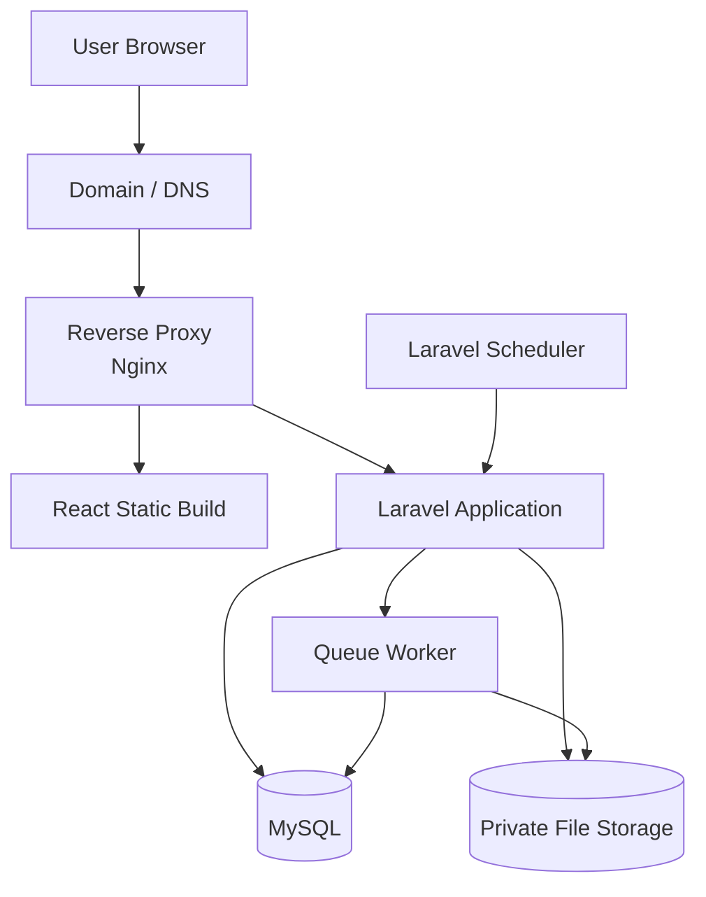

## 15.2 Komponen Server

- Linux VPS.
- Nginx sebagai reverse proxy.
- React hasil build disajikan sebagai static assets.
- Laravel dijalankan melalui PHP-FPM.
- MySQL untuk database.
- Queue worker sebagai proses service terpisah.
- Scheduler melalui cron/systemd timer.
- Private storage pada disk server atau object storage privat.
- HTTPS melalui sertifikat TLS.

Untuk MVP satu VPS dapat digunakan jika kapasitas memadai. Database dan file harus tetap memiliki backup terpisah. Pemisahan database ke server tersendiri dapat dipertimbangkan jika kebutuhan operasional meningkat.

## 15.3 Environment

Pisahkan minimal:
- Local development.
- Testing/staging.
- Production.

Environment variable sensitif:
- Database credentials.
- App key.
- Session/cookie settings.
- Storage credentials.
- Mail/notification credentials jika kelak digunakan.

Jangan memasukkan `.env` ke Git.

## 15.4 Proses Release

1. Review pull request.
2. Jalankan test otomatis.
3. Build frontend.
4. Backup database sebelum migration yang berisiko.
5. Deploy backend dan frontend.
6. Jalankan migration.
7. Restart worker.
8. Verifikasi scheduler aktif.
9. Smoke test login, kamar, invoice, pembayaran, dan keluhan.
10. Pantau log setelah release.

Migration harus kompatibel dengan data yang sudah ada. Hindari migration destruktif tanpa backup dan rencana rollback.

## 15.5 Backup dan Recovery

Mengikuti PRD:
- Backup database harian.
- Retensi awal minimal tujuh hari.
- Simpan backup di lokasi terpisah dari server aplikasi jika memungkinkan.
- File upload harus memiliki backup tersendiri.
- Dokumentasikan prosedur restore.
- Uji restore secara berkala.
- Tetapkan siapa yang bertanggung jawab memeriksa backup.

---

# 16. Kebutuhan Non-Fungsional dan Target Teknis

| Area | Target rancangan |
|---|---|
| Responsivitas | Mendukung lebar layar mulai 360 px |
| Performa | Halaman utama di bawah 3 detik pada skenario 4G yang didefinisikan |
| Pagination | Daftar utama menggunakan pagination |
| File | Validasi dan kompresi foto |
| Keamanan | HTTPS, hash password, RBAC/policy, rate limit, private storage |
| Integritas | DB transaction, foreign key, unique constraint, idempotency |
| Timezone | `Asia/Jakarta` untuk jadwal dan tampilan waktu bisnis |
| Mata uang | Integer Rupiah |
| Backup | Harian, retensi awal minimal 7 hari |
| Audit | Perubahan penting dapat ditelusuri |
| Availability | Target formal ditetapkan setelah infrastruktur dan jam operasional dikonfirmasi |

Target performa perlu diuji dengan definisi perangkat, ukuran data, dan jaringan yang jelas. Target availability formal belum ditetapkan oleh PRD.

---

# 17. Strategi Pengujian Teknis

## 17.1 Unit Test

Fokus:
- Perhitungan periode 1/6/12 bulan.
- Anchor date 29–31.
- Penentuan status invoice berdasarkan due date.
- Transisi status invoice dan keluhan.
- Perhitungan saldo deposit.
- Validasi nominal pembayaran.
- Penentuan status kamar.

## 17.2 Feature/Integration Test

Fokus:
- Login, lockout, dan ganti password.
- Owner dan tenant authorization.
- Penempatan penyewa secara atomik.
- Pencegahan dua occupancy aktif pada kamar yang sama.
- Penerbitan invoice idempotent.
- Upload bukti dan verifikasi.
- Penolakan bukti dan upload ulang.
- Pembayaran tunai.
- Pembatalan dan penerbitan ulang invoice.
- Pindah kamar dan keluar.
- Keluhan dan auto-confirmation.
- Isolasi notifikasi antar-user.

## 17.3 Security Test

- Penyewa mencoba mengakses invoice milik penyewa lain.
- Penyewa mencoba membuka bukti pembayaran pengguna lain.
- Penyewa mengirim request ke endpoint owner.
- User nonaktif mencoba login.
- Brute force login.
- Upload file dengan MIME/ekstensi tidak sesuai.
- Manipulasi nominal dan `user_id` dari browser.
- IDOR pada invoice, payment, complaint, dan file.
- CORS/CSRF sesuai pola deployment.

## 17.4 Uji Konsistensi Transaksi

| Skenario | Hasil yang diharapkan |
|---|---|
| Dua pemilik request menempatkan penyewa pada kamar sama hampir bersamaan | Hanya satu berhasil |
| Scheduler berjalan dua kali | Invoice tidak duplikat |
| Dua request verifikasi menerima payment sama | Hanya satu perubahan berhasil |
| Pembuatan invoice gagal saat penempatan | Seluruh transaksi penempatan rollback |
| Notifikasi gagal | Transaksi utama tetap tersimpan |
| Upload berhasil tetapi DB gagal | File orphan ditangani melalui cleanup |
| Invoice dibatalkan | Invoice lama tetap tersimpan dan tidak bisa dibayar |

---

# 18. Pemetaan Implementasi ke Sprint

| Sprint | Fokus teknis | Output |
|---|---|---|
| 1 – Foundation | Repository, environment, ERD, migration inti, auth, policy, kamar, tipe kamar, fasilitas | Fondasi sistem dan master data |
| 2 – Tenant & Occupancy | Tenant, penempatan, pindah, keluar, deposit, invoice pertama | Siklus hunian berjalan |
| 3 – Billing & Payment | Scheduler, periode, invoice, upload bukti, verifikasi, cash, histori, notifikasi | Siklus tagihan dan pembayaran |
| 4 – Complaint & Release | Keluhan, foto, histori, dashboard, security test, UAT, deployment | MVP siap demo/rilis |

## 18.1 Urutan Dependency Pengembangan

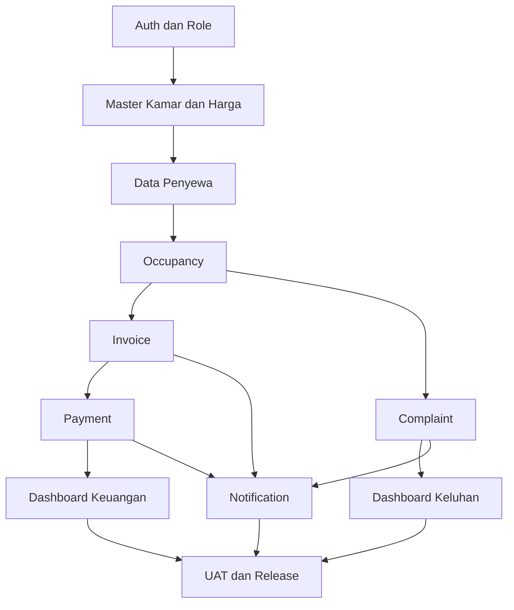

## 18.2 Pembagian Kerja yang Disarankan

| Peran | Tanggung jawab |
|---|---|
| Backend Developer 1 | Auth, user, room, tenant, occupancy |
| Backend Developer 2 | Billing, payment, deposit, complaint, scheduler, notification |
| Frontend Developer 1 | Layout, auth, dashboard owner, master kamar, tenant |
| Frontend Developer 2 | Occupancy, invoice, payment, complaint, tenant portal |
| PM/DB/QA | ERD, API contract, prioritas, acceptance criteria, test plan, UAT |

Pembagian ini perlu disesuaikan kemampuan aktual anggota. Backend dan frontend harus menyepakati API contract sejak Sprint 1.

---

# 19. Keputusan Desain yang Masih Terbuka

Bagian berikut tidak boleh diputuskan sepihak oleh implementasi karena PRD menandainya perlu validasi stakeholder.

| No. | Topik | Dampak teknis |
|---|---|---|
| 1 | Tunggakan dan perpanjangan | Aturan penerbitan invoice baru dan status hunian |
| 2 | Pindah kamar dengan tunggakan | Validasi use case transfer |
| 3 | Keluar sebelum periode selesai | Perhitungan sisa sewa/refund |
| 4 | Deposit untuk menutup tunggakan | Jenis transaksi deposit dan rekonsiliasi |
| 5 | Penghuni tambahan satu kamar | Kardinalitas occupancy dan model penghuni |
| 6 | Perubahan invoice terbit | Alur cancel/reissue dan approval |
| 7 | Anchor tanggal sewa | Perhitungan periode dan jatuh tempo |
| 8 | Rekening transfer | Struktur settings dan tampilan invoice |
| 9 | Retensi data penyewa | Proses anonimisasi/penghapusan |
| 10 | Verifikasi perubahan nomor HP | Alur pemulihan akun |

## 19.1 Rekomendasi Keputusan Sebelum Coding

Prioritaskan konfirmasi:
1. Satu kamar hanya satu penyewa utama atau bisa lebih dari satu penghuni.
2. Tanggal mulai periode dan jatuh tempo untuk tanggal masuk 29–31.
3. Aturan pindah kamar di tengah periode.
4. Aturan penyewa keluar sebelum periode berakhir.
5. Aturan deposit dan tunggakan.
6. Prosedur reset password dan perubahan nomor HP.

Keputusan tersebut memengaruhi ERD dan business logic. Perubahan setelah implementasi akan menambah risiko migrasi dan bug.

---

# 20. Definition of Technically Ready

Sistem dapat dinyatakan siap untuk UAT apabila:

- [ ] Login pemilik dan penyewa berjalan.
- [ ] Otorisasi backend diuji untuk seluruh modul utama.
- [ ] Pemilik dapat mengelola kamar, tipe kamar, dan harga.
- [ ] Pemilik dapat membuat akun penyewa.
- [ ] Penempatan penyewa membuat occupancy dan invoice pertama secara konsisten.
- [ ] Satu kamar tidak dapat memiliki dua occupancy aktif.
- [ ] Pindah kamar mempertahankan histori occupancy dan invoice lama.
- [ ] Scheduler menerbitkan invoice tanpa duplikasi.
- [ ] Bukti pembayaran tersimpan privat.
- [ ] Verifikasi dan penolakan pembayaran memiliki histori.
- [ ] Pembayaran tunai tercatat dengan aktor dan waktu.
- [ ] Invoice batal tidak dapat dibayar.
- [ ] Deposit memiliki histori transaksi.
- [ ] Keluhan memiliki status dan histori transisi.
- [ ] Notifikasi tidak bocor antar-user dan tidak duplikat.
- [ ] Dashboard menggunakan definisi agregasi yang disepakati.
- [ ] Backup database dan file diuji.
- [ ] Tidak ada bug kritis atau celah akses data antarpenyewa.

---

# 21. Catatan Penutup

Rancangan ini menerjemahkan PRD KostKuy v1.2 menjadi struktur implementasi teknis. Fokus utama bukan membuat sebanyak mungkin tabel atau endpoint, melainkan menjaga konsistensi alur bisnis: kamar → penyewa → occupancy → invoice → payment, serta keluhan → penanganan → histori.

Tiga keputusan arsitektur paling penting untuk dijaga selama development:

1. **Occupancy menjadi pusat riwayat hunian.** Invoice harus terikat pada occupancy agar perpindahan kamar tidak merusak histori.
2. **Transaksi pembayaran harus immutable secara operasional.** Penolakan, pembatalan, dan koreksi dicatat sebagai histori, bukan menghapus data lama.
3. **Backend mengendalikan aturan bisnis dan akses data.** Frontend hanya menyajikan alur dan mengirim perintah; keputusan status, nominal, kepemilikan, dan validasi akhir tetap berada di server.

Dokumen ini merupakan rancangan teknis awal. ERD final, migration, kontrak payload API, dan detail kebijakan yang masih terbuka perlu direview bersama tim dan pemilik kost sebelum implementasi penuh.
